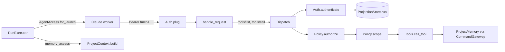

# TRD: Scoped agent credential for the Foreman MCP boundary (project memory write)

## Metadata

| Field | Value |
|---|---|
| Document ID | TRD-2026-94f379ec |
| Label | trd-agent-mcp-credential |
| PRD Reference | docs/PRD/PRD-2026-94f379ec-agent-scoped-mcp-credential.md |
| Version | 1.0.0 |
| Status | Draft |
| Correlation ID | 94f379ec (shared with source PRD) |
| Design Readiness Score | 4.5 (PASS) |

## Source Task

Implement `PRD-2026-94f379ec` v1.0.0: give a Foreman-launched Claude workflow
agent a per-run MCP credential that lets it list, read, write and forget **its own
project's** memory under the shipped default posture (`allow_workflow_writes:
false`), while the operator principal stays unrestricted and unchanged, and make
the standing memory guidance true for every launch.

Path convention for this document: paths beginning `lib/` or `test/` are under
`packages/foreman_server/`. Every other path is repo-relative.

**Process (D5).** PRD, then this TRD, then step beads as a separate follow-up.
No beads are created by this document.

## Requirements Validation

Source PRD validated before ingestion:

| Check | Result |
|---|---|
| Required sections present | PASS — Problem Statement, Goals, Non-Goals, Assumptions, Requirements, Dependency Map, Readiness Gate, Constitution Gate |
| REQ-NNN sequential and unique | PASS — REQ-001 … REQ-016, no gaps |
| ACs in Given/When/Then | PASS — 42/42 |
| Every Must has at least 2 ACs | PASS — 14 Must, minimum 2 each |
| Constraints and Non-Goals documented | PASS — 12 Non-Goal bullets, 9 assumptions, 3 external dependencies |
| Readiness score | 4.5 — PASS (at least 4.0), proceed normally |
| Open ambiguity markers | 0 (six judgement calls J1-J6 recorded with defaults) |

Every claim about the code below cites a `file:line` read while writing it.
Anything not read, or not provable by reading, is marked `[INFERENCE]`.

## Domain Analysis

**Project type: brownfield.** Every touched module exists except three new ones
(`MCP.Principal`, `MCP.AgentToken`, `MCP.AgentAccess`).

| Domain | Requirements | Surface |
|---|---|---|
| MCP authentication | REQ-001, REQ-002, REQ-003 | `lib/foreman_server/mcp/auth.ex`, new `agent_token.ex`, new `principal.ex` |
| MCP policy and enforcement | REQ-004 … REQ-008, REQ-014 | `mcp/policy.ex`, `mcp/dispatch.ex`, `mcp.ex`, `mcp/stdio.ex`, `mcp/tools.ex`, `application.ex` |
| Worker injection | REQ-009, REQ-010, REQ-011 | `workflow/run_executor.ex`, `approvals/config.ex`, new `mcp/agent_access.ex` |
| Guidance and surfaces | REQ-012, REQ-013 | `project_context.ex`, `project_context/*`, `project_memory/guidance.ex`, `project_controller.ex`, `packages/foreman_cli/cmd/foreman/agent_commands.go` |
| Verification and docs | REQ-014 … REQ-016 | tests, `scripts/e2e/`, documentation set |

No new event, command, aggregate, projection, route or database migration. No
UI. One new Go test; the Go change is a description string.

**Existing-code inventory** (read this session; paths under `packages/foreman_server/`):

| Concern | Current state |
|---|---|
| Tool-call boundary | `Dispatch.call/4` authenticates (`Auth.verify_request/3`), then `Policy.authorized?/1`, then `Tools.call_tool/2` — `mcp/dispatch.ex:62-75`. The only `lib/` caller of `Tools.call_tool/2`. |
| Tool visibility | `Dispatch.components/0` builds tools from `Tools.list_tools/0` filtered by `Policy.list_tools/1` — `dispatch.ex:40-53`. Both servers return it from `__components__(:tool)` — `mcp.ex:29`, `mcp/stdio.ex:30`. |
| Write gate | `Policy.authorized?/1` reads only `:mcp, allow_workflow_writes` — `mcp/policy.ex:52-64`, `:75-77`. 27 write tools in `@write_tools` — `:4-32`. |
| Gate inside tools | `authorize_write_tool/1` — `mcp/tools.ex:2894-2900`, called at `:1939`, `:1969`, `:2017`, `:2159`, `:3160`; plus `:2658-2668`, `:3729`, `:3804`, `:3887`, `mcp/repo_tools.ex:125-135`. |
| Authentication | `verify_token/1` (`mcp/auth.ex:34-60`), `verify_request/3` (`:69-82`), Plug `call/2` (`:88-101`). A string token under `allow_insecure_local` with no operator token returns `:ok` for **any** string (`:43-52`). |
| stdio | `init/2` verifies once and stores the raw token in assigns; `handle_tool_call/3` re-verifies per call — `mcp/stdio.ex:59-90`. |
| Per-run credential precedent | `Inflight.token/1`: HMAC-SHA256, `"agent-permission:" <> run_id`, url-safe base64 without padding — `approvals/inflight.ex:68-73`; `Plug.Crypto.secure_compare` at `:75-80`; key must be a binary of at least 32 bytes, else raises — `:292-301`. |
| Claude launch options | `driver_opts` at `workflow/run_executor.ex:1528-1539`; `maybe_put_inflight_permission` with `Keyword.merge` that replaces `:mcp_config` — `:1613-1623`. |
| Harness | `:mcp_config` map becomes `--mcp-config '{"mcpServers": …}'`; `:allowed_tools` becomes `--allowedTools` — `packages/jido_harness/lib/jido_harness/adapters/claude.ex:44`, `:113-116`, `:183-185`. |
| Run lifecycle in the projection | `terminal?` set true for completed, failed, cancelled, `deleted` (`lib/foreman_server/projection_store.ex:4124`, `:4137`, `:4168`, `:4807-4816`, `:2566-2568`) and `failed`/`blocked`/`stuck` (`:4941`). `paused` is non-terminal (`aggregates/run.ex:566-586`). A run-keyed event for an unknown id mints a stub with `project_id: nil`, `terminal?: false` — `projection_store.ex:5049-5072`. |
| Allowlist | `Agents.McpAllowlist` child (`application.ex:181`, `:625-631`) and seed (`:259`, `:635-642`); `permit?/1` has no `lib/` caller (`agents/mcp_allowlist.ex:20`). |

## Reused Capabilities

`trd-graph-cli capabilities docs/TRD --json` returned `{"capabilities": []}`:
no earlier TRD declares a reusable capability. Code-level reuse:

| Reused | Where | For |
|---|---|---|
| HMAC-over-`secret_key_base` scheme and constant-time compare | `approvals/inflight.ex:68-80`, `:292-301` | Credential (DP-1). A different domain prefix and wire shape; the function is not reused verbatim. |
| `Approvals.Config.inflight_base_url/0` | `approvals/config.ex:89-110` | Loopback base URL for the injected server. `nil` means unavailable. |
| `Telemetry.mcp_policy_refused` | `telemetry.ex:386-396` | Audit of denied agent calls (DP-11). |
| `WorkerLogPolicy.redact/2` | `overwatch/worker_log_policy.ex:45-59` | Bare-token redaction (it already redacts `Bearer …`). |
| `ProjectContext.build/2` as the one producer | `project_context.ex:42` | Guidance derivation (DP-9). |
| `Policy.write_tools/0` | `mcp/policy.ex:4-32` | Operator write gate stays; the agent set is separate. |
| Run seeding pattern | `test/foreman_server/approvals/permission_prompt_test.exs:19-42` | Active-run fixtures; message-driven, no sleeps. |

## Architecture Decision

### Option A (chosen): one boundary, two principals

`Auth.authenticate/1` turns a bearer token into a typed `%Principal{}` (operator
or agent). `Dispatch.call/4` — already the single enforcement point — runs
authenticate → authorize → scope → `Tools.call_tool/2`. `Policy` owns the explicit
agent set, authorization, listing and scope. A principal-aware `handle_request/2`
on both Anubis servers makes `tools/list` and tool resolution agree with dispatch.

### Alternatives considered

| Option | Verdict | Why |
|---|---|---|
| B. A separate endpoint (`/agent-mcp/:run_id`) with its own server | Rejected | A second boundary to keep in step with the first; the repo's lesson is one enforcement point (`dispatch.ex:2-11`). The run id would also sit in a URL that appears in logs. |
| C. Widen the gate (`allow_workflow_writes: true` for all) or hand agents the operator token | Rejected | Unlocks 27 write tools and every project for every agent; the operator token inside a worker is the exact exposure this PRD exists to avoid. |
| D. Agents write memory through the Go CLI | Rejected | The CLI needs `FOREMAN_API_TOKEN` and the server URL, neither of which workers are given (`run_executor.ex:4154-4248`), and it is token-protected (`bearer_auth.ex:37-54`). Same missing credential, different transport. |
| E. Stateful tokens (stored, revocable) | Rejected | State to persist, clean and lose on restart. The run's own lifecycle already says when a credential must die (DP-2). |

### Key technical decisions

| Decision | Choice |
|---|---|
| Credential | Stateless HMAC-SHA256, domain-separated, run-bound; no embedded project (DP-1) |
| Liveness | Run projection lookup per authentication; `terminal?` plus non-blank `project_id`; fail closed (DP-2) |
| Identity type | `%Principal{kind, project_id, run_id}`; `authenticate/1` replaces `verify_token/1` and callers migrate (DP-3) |
| Enforcement | Dispatcher only; two in-body gates removed, others kept (DP-4) |
| Visibility | `handle_request/2` override sets `frame.tools` per principal (DP-5) |
| Agent set | 17 explicit tools, all `project_id`-addressed (DP-6) |
| Injection | Claude workflow door only; server key `foreman_agent`; four pre-approved names (DP-7) |
| Guidance | `ProjectContext.build/2` option `:memory_access`, set from the same decision (DP-9) |
| `McpAllowlist` | Not consulted by the boundary; production wiring removed, module and tests kept (DP-10) |

## Design Points

### DP-1: Credential format

**Choice.** `fmcp1.<b64url(run_id)>.<b64url(mac)>` (url-safe base64, no padding),
where `mac = HMAC-SHA256(secret_key_base, "agent-mcp-v1:" <> run_id)`. Minting is
deterministic. Verification parses the prefix and the two segments, recomputes the
MAC and compares with `Plug.Crypto.secure_compare/2`.

| Alternative | Verdict |
|---|---|
| `Plug.Crypto.sign` payload with project and `max_age` | Rejected. The project would go stale or need a second lookup anyway; `max_age` is a guess at run length when the projection already knows. |
| Reuse `Inflight.token/1` verbatim | Rejected. Inflight is bound to its run by URL path (`agent_permission_controller.ex:31-44`). `/mcp` is one URL, so the approval token the worker already holds would become an MCP credential. |
| Stateful store | Rejected (option E above). |

**Domain separation, both directions.** The agent MAC prefix `agent-mcp-v1:` differs
from Inflight's `agent-permission:`, and the wire shape differs (Inflight is 43
characters with no dot; an agent token starts `fmcp1.` and has two dots). Tests
assert an Inflight token fails `AgentToken.verify/1` and an agent token fails
`Inflight.valid_token?/2`.

**An `fmcp1.`-shaped bearer is verified only as an agent token.** It never falls
through to the operator comparison. This closes the hole at `auth.ex:43-52`, where
with no operator token and `allow_insecure_local` any string is accepted.

**Secret handling.** Unlike `Inflight.secret/0`, the agent path never raises: a
missing or short `secret_key_base` yields `{:error, :no_secret}` from minting and
`:error` from verification, so authentication cannot crash a request.
`secret_key_base` rotation invalidates every agent and in-flight token (Deferred).

### DP-2: Run → project, liveness, and failure handling

`Auth.authenticate/1` for an agent-shaped token: verify the MAC (`{:ok, run_id}`),
then `ProjectionStore.run(run_id)` (`projection_store.ex:300-303`, a `GenServer.call`).

| Lookup result | Outcome |
|---|---|
| `nil` | `{:error, :run_not_active}` |
| run with `terminal?: true` | `{:error, :run_not_active}` |
| run with `project_id` nil or blank (a stub; `projection_store.ex:5049-5072`) | `{:error, :run_not_active}` |
| run with `terminal?: false` and a non-blank binary `project_id` | `{:ok, Principal.agent(project_id, run_id)}` |
| lookup exits or times out | `{:error, :projection_unavailable}` and a `Logger.error` naming the run id, never the token |

**Why `terminal?` and not `ProjectionStore.active_run_statuses/0`** (`:50`, `:129-130`):
that list is a dispatch notion; a `paused` run is not terminal and its worker may
resume, so its credential must keep working (REQ-002).

**Failure mapping.** HTTP edge: 401 for the first three and for invalid/missing
tokens, 503 `{"error":"unavailable"}` for `:projection_unavailable`. Tool call:
`UNAUTHORIZED` for the same first group; `AUTH_UNAVAILABLE` (wire code -32000 by the
existing default at `dispatch.ex:150`) for `:projection_unavailable`.

**Constitution note.** The lookup decides whether to accept one HTTP request; it
is a read-side query at the request boundary, as every MCP read tool already makes,
not orchestration.

### DP-3: Principal type and the authentication migration

`ForemanServer.MCP.Principal`: `@enforce_keys [:kind, :project_id, :run_id]`, a
`@type t`, `kind` is `:operator` or `:agent`; constructors `operator/0` (project and
run nil) and `agent/2`. Exactly two kinds, so every consumer matches both with no
catch-all clause (the repo's no-catch-all rule; cf. `dispatch.ex:119-122`).

`Auth.authenticate/1` and `Auth.authenticate_request/3` return
`{:ok, Principal.t()}` or `{:error, :no_token_configured | :invalid_token | :run_not_active | :projection_unavailable}`.
`verify_token/1` and `verify_request/3` are **deleted**, not kept as aliases, so a
stale caller fails to compile. Callers to migrate: `auth.ex:71-82` (internal),
Plug `auth.ex:88-101`, `dispatch.ex:66`, `stdio.ex:73`, and `test/foreman_server/mcp/auth_test.exs:28,35,42,49,56,57,82`.

**Transitional safety.** In the PR that introduces principals, `Dispatch.call/4`
refuses an agent principal outright, so no PR boundary lets an agent reach the
operator policy. The enforcement PR removes that clause.

The Plug and `Dispatch.strip_bearer/1` remain two bearer-header *extractors*
(HTTP edge, and `frame.context.headers`/`init_meta`); both feed the one
authentication function. [Observed, not changed: the Plug accepts a lowercase
`bearer ` scheme (`auth.ex:115-121`) while `strip_bearer` strips only `Bearer `
(`dispatch.ex:87-91`).]

### DP-4: One enforcement point, and the in-body write gates

Order in `Dispatch.call/4`: **authenticate → authorize → scope → `Tools.call_tool/2`.**

- Operator: `Policy.authorize(operator, tool)` is exactly `Policy.authorized?/1`
  (D3). `authorized?/1` stays, as the operator-posture check.
- Agent: `tool in Policy.agent_tools()`, in every posture. D1's "otherwise fall
  through to `Policy.authorized?/1`" applies to non-agent principals only (J2): a
  literal fall-through would give an agent every tool whenever the gate is on.
- Authentication runs up to three times for an agent `tools/call` (edge Plug,
  visibility, dispatch); the operator path makes no projection call. The dispatch
  pass decides, so a run that ends between visibility and execution is caught.

**The gate is also inside tool bodies** (`tools.ex:1939` and `:1969` for the memory
tools; about 18 more sites). A caller-blind in-body gate would refuse the agent's
write under `allow_workflow_writes: false` after dispatch had allowed it.

| Option | Verdict |
|---|---|
| Drop the in-body gate for the two memory tools only; dispatch is their sole gate | **Chosen.** Smallest change that makes D1 true. |
| Collapse every in-body gate into the dispatcher | Deferred. About 20 sites and 8 test files pin the `POLICY_REFUSED` codes at the `Tools.call_tool/2` level. |
| Thread the principal into every tool implementation | Rejected. Churn across about 60 `tool_*` functions for no behaviour gain. |
| Ambient process-dictionary principal, or smuggling it in `args` | Rejected. Hidden state and an argument a caller can forge. |

The remaining in-body gates never see an agent: an agent can only reach tools in
`agent_tools/0`, and none of those has a surviving in-body gate. The existing test
at `test/foreman_server/mcp/tools_project_memory_test.exs:57-73` (refusal at the
`Tools.call_tool/2` level) is re-pointed through `Dispatch.call/4` as the operator.

### DP-5: Principal-aware visibility on both transports

Anubis resolves a tool by name from `module.__components__(:tool) ++ Frame.get_tools(frame)`
before `handle_tool_call/3` runs, and `__components__/1` takes no frame
(`deps/anubis_mcp/lib/anubis/server/handlers.ex:51-53`; `handlers/tools.ex:31-43`;
anubis_mcp 1.14.0). A tool hidden by the gate is therefore "Tool not found" over the
wire and never reaches `Dispatch`, so D1 cannot work with a static list. Registering
at `init/2` is not viable either: `init` runs on `notifications/initialized` with
empty headers (`deps/anubis_mcp/lib/anubis/server/session.ex:752-757`), and each
request runs in a fresh task (`session/scheduler.ex:175-181`).

**Design.** `ForemanServer.MCP` and `ForemanServer.MCP.Stdio` override
`handle_request/2` (documented, `defoverridable`: `server.ex:162-170`, `:382-392`) and
delegate to `Dispatch.handle_request/4`. For `tools/*` requests it authenticates the
transport's token, sets `frame.tools` (documented `%{name => %Tool{}}`,
`frame.ex:14`) to `Dispatch.components(principal)`, calls
`Anubis.Server.Handlers.handle/3`, and restores the original `frame.tools` on the
returned frame. Every other request passes straight through. Static
`__components__(:tool)` becomes `[]`, so a missed hook fails closed.
`Dispatch.components/0` becomes `components/1`.

- **Rejected:** `Frame.register_tool/3` (it builds validators from option lists; we
  already hold finished `%Tool{}` structs); registering at `init/2`; a custom
  Anubis transport.
- **Over the wire** an out-of-set tool is "not found"; a direct `Dispatch.call/4`
  returns `POLICY_REFUSED`. Both are asserted.
- **Risk.** `Anubis.Server.Handlers.handle/3` is an internal the generated default
  also calls; the pin is `~> 1.10` in `mix.exs:63`, locked 1.14.0. The full-stack
  HTTP test (`test/foreman_server/mcp/http_boot_test.exs`) is the contract test.
- **Consequence.** About 14 test lookups of `MCP.__components__(:tool)` or
  `Dispatch.components()` change: `approvals_tool_test.exs:79`,
  `mcp_transport_test.exs:37,48,56,62,68,184,185,217,220`, `pr_tools_test.exs:74`,
  `questions_tool_test.exs:96`, `tools_project_memory_test.exs:191` (all under
  `test/foreman_server/mcp/`) and `test/foreman_server_web/overview_scheduled_tab_test.exs:59`.
  The "tool set identity" test at `mcp_transport_test.exs:182-232` becomes non-vacuous.

### DP-6: The agent set, project scope, and the error class

**The agent set is 17 tools, all addressed by `project_id`.** Extracted from the
tool schemas: 62 advertised tools; 27 write, 35 read (`tool_inventory_test.exs:82`);
15 of the 35 reads declare `project_id` as required.

| Group | Tools |
|---|---|
| Project reads (15) | `foreman_project_get`, `foreman_project_settings_get`, `foreman_project_environment_get` (names only, `tools.ex:2415-2436`), `foreman_project_recommendations`, `foreman_project_repo_list`, `foreman_project_memory_list`, `foreman_project_memory_read`, `foreman_project_library_list`, `foreman_project_library_read`, `foreman_project_conversation`, `foreman_thread_list`, `foreman_thread_find`, `foreman_schedule_list`, `foreman_usage_get`, `foreman_questions_list` |
| Memory writes (2) | `foreman_project_memory_write`, `foreman_project_memory_forget` |

**Withheld (20 reads, J1):** keyed by run (7: `foreman_run_get`, `foreman_run_status`,
`foreman_run_get_logs`, `…_events`, `…_activity`, `foreman_inbox_get`, `foreman_pr_status`),
task (1), thread (2: `foreman_thread_get`, `…_transcript`); global
(`foreman_queue_status`, `foreman_project_list`, `foreman_doctor`); catalog (4:
`foreman_workflow_list`, `…_get`, `…_validate`, `foreman_prompt_get`); optional
project (`foreman_overview`, `foreman_task_list`, `foreman_approvals_list`). An id
that is not a project id cannot be checked against the principal without a
lookup, and a global tool reads across projects. Widening is one list entry plus
an owner-resolution rule (Deferred).

**Invariant, enforced by test.** Every `agent_tools/0` member exists in the
advertised inventory, requires `project_id`, and declares no other `*_id` property
except pinned exceptions: `run_id` and `session_id` on the two memory tools
(attribution; overridden below) and `entry_id` on `foreman_project_library_read`
(resolved under the project's own library root: `library.ex:100-103`,
`library/store.ex:194-201`, path containment `:214-233`).

**Scope.** For every agent call, `args[:project_id]` must equal the principal's
`project_id` by exact string equality (no trimming or case folding). Arguments reach
`Dispatch.call/4` with schema-declared keys already atomised (`dispatch.ex:152-171`),
so scope reads `:project_id` only; a string-keyed `"project_id"` bypassing that
boundary reads as absent and is refused.

| Case | Code | Why |
|---|---|---|
| `project_id` differs from the principal's | `POLICY_REFUSED` | A policy decision, not a lookup, so there is no existence oracle (a `NOT_FOUND` would confirm another project exists). Checked before the tool runs and touches no store. Distinct from "not found" and "invalid" per the repo's distinct-outcomes rule (cf. `tools.ex:1376-1382`). |
| `project_id` absent, blank or not a string | `INVALID_PARAMS` | Malformed input (D4). |
| tool outside the set | `POLICY_REFUSED` | Same class as today's gate refusal. |

**Attribution.** For the two memory tools the dispatcher overrides `args[:run_id]`
with the principal's `run_id` (a caller value is discarded). The author reference is
`Map.get(args, :run_id) || Map.get(args, :session_id)` (`tools.ex:2107-2108`), so
the audit event cannot be forged by an argument. The operator path is unchanged.

### DP-7: Injection (workflow door only)

**Door A — `workflow/run_executor.ex`.** Compute `AgentAccess.for_launch(run_id,
project_id, provider)` once, before the `driver_opts` closure (`:1528`), and merge
its result into the options. The existing in-flight hook (`:1613-1623`) replaces
`:mcp_config` through `Keyword.merge` (`:1617`); both injections move to one
shared merge of the `mcp_config` **map** (`Map.merge`) so they compose in either
order. `Inflight.claude_options/1` keeps its shape (pinned by
`test/foreman_server/approvals/permission_prompt_test.exs:292`).

**Server key is `foreman_agent`, not `foreman` (J4).** Claude's documentation says
duplicate server names connect once, using the highest-precedence source (local >
project > user > plugin > connectors), and `--mcp-config` is not in that list
(https://code.claude.com/docs/en/mcp, read 2026-11-02). The e2e scripts register an
operator `foreman` entry, so a worker-side `foreman` entry could silently lose to
it. Entry: `%{"foreman_agent" => %{"type" => "http", "url" => base <> "/mcp",
"headers" => %{"Authorization" => "Bearer " <> token}}}`.

**Pre-approval.** `allowed_tools` gets exactly four names,
`mcp__foreman_agent__foreman_project_memory_list`, `_read`, `_write`, `_forget`,
union-merged with whatever is present; no glob. Claude's allow rules accept a glob
only after a literal `mcp__<server>__` prefix
(https://code.claude.com/docs/en/permissions). No server code sets `allowed_tools`
today (grep found none); the adapter emits `--allowedTools` at `claude.ex:113`.
Headless Claude denies a call that would prompt (`workflow/run_executor.ex:1584-1589`,
`jobsite/agent.ex:3-10`; MCP tools [INFERENCE] from the documentation), so without
this the tools would be offered and then denied.

**Base URL.** `Approvals.Config.inflight_base_url/0` (`config.ex:89-110`): loopback on
the Endpoint HTTP port (dev 4766, `config/dev.exs:13-14`) or `:inflight_base_url`;
`nil` means unavailable. (The job brief's "`config.exs` ~85-94" is wrong: there is no
`:approvals` block in `config.exs`.)

**Door B — the jobsite launch paths — is excluded in this slice and pinned by a
negative test.** Reasons: no run exists in the projection for a jobsite (the
scripted launch uses the jobsite id as run id, `jobsite/runners/overwatch.ex:263`),
and D4's principal is run-keyed; the agent may run inside a Docker shim where
loopback is not the host (`jobsite/agent_runner.ex:186-189` [INFERENCE]). There are
two sub-paths: `AgentRunner.build_request` (`agent_runner.ex:166-214`) and
`Runners.Overwatch.scripted_launch/4` (`runners/overwatch.ex:259-291`). Both are
covered by the pin.

**Pi gets nothing** (D2). **The coordinator** (`coordinator/context/sources/live.ex:19`)
keeps the read-only default.

### DP-8: Feature switch and degradation

New key `config :foreman_server, :mcp, agent_credentials: true` (added to the block
at `config/config.exs:66-71`; kill switch, default true). `AgentAccess.for_launch/3`
returns `:unavailable` unless **all** hold: `:mcp, enabled`; the switch; a Claude
provider; a non-blank `project_id`; a base URL; a valid `secret_key_base` (minting
succeeds). `:unavailable` leaves the options exactly as they were.

`:mcp, enabled` is false in `config.exs` and `test.exs` and true in `dev.exs`;
`config/runtime.exs` has no env var for it (J6), so a release operator must set the
key. The seed call at `application.ex:259` is replaced by a **boot-time
availability log**: `Logger.warning` when MCP is enabled but agent credentials are
unusable (names the reason), `Logger.info` when disabled by config. It runs after
`Supervisor.start_link` because the base URL needs `Endpoint.config(:http)`.
Per-launch decisions are silent.

### DP-9: Guidance derived from the launch

`ProjectContext.build/2` (`project_context.ex:42`) gains option `:memory_access`,
`:read_only` (default) or `:read_write`; any other value raises `ArgumentError`.
`SectionProvider.section/1` becomes `section/2(project_id, opts)`; migrate `Memory`
(`project_context/memory.ex:22`), `Library` (`library.ex:17`) and the fakes at
`test/foreman_server/project_context_test.exs:10-17`.

`ProjectMemory.Guidance` (`project_memory/guidance.ex:9-38`): `text/0` is unchanged
(pinned by `guidance_test.exs:51-57`; also embedded in tool descriptions via
`tool_description/1`). Added: a read-only text that names **no tool** and says the
notes are read-only for this session and changes go through the operator, and
`for_access(access, project_id)`. The `:read_write` text names the project id and is
emitted **even for an empty memory index** (J5); today `memory.ex:25` skips the
whole section when the index is empty. The truncation hint in a read-only render
must not point at an unreachable tool.

**One decision per launch.** `run_executor.ex:2438` (`project_context_bundle/2`, `:2435`)
is used at `:1479` (launch) and `:2563` (`prompt_template_assigns/4`, `:2551`); both
take the access from the same `AgentAccess` result (provider from `context` via
`request_provider/1`, `agent_runtime/jido_harness.ex:39-50`). `jobsite/executor.ex:490`,
`coordinator/context/sources/live.ex:19` and `project_controller.ex:100` keep the
read-only default. `GET /api/projects/:id/context` reports `memory_access`
(`project_controller.ex:9,99-115`). Bundled prompts already render `{{project_id}}`
(`prompt_template_assigns` exposes it), so they need no change.

**CLI description.** `packages/foreman_cli/cmd/foreman/agent_commands.go:271` says
agents write memory through the MCP tool; these are generated command assets
(`foreman commands generate|install`, `:69-78`), not worker-injected, so the text is
reworded to be conditional. `agent_commands_test.go:54,223-246` pin ids and flags
but not descriptions; a Go test is added. (No `usage_drift` test exists in
`packages/`; a grep for it matched nothing.)

### DP-10: `McpAllowlist`

**Decision: not consulted by the boundary; production wiring removed; module and
tests kept.** A mutable global GenServer on the enforcement path loses state on
restart, adds a `Logger.warning` per denial (`agents/mcp_allowlist.ex:44`), and
would be a second copy of the agent set, violating "defined once in `Policy`". The
child (`application.ex:625-631`, used at `:181`), the seed (`:635-642`, called at
`:259`) and `Policy.read_tool_names/0` (`policy.ex:47-50`) are removed.
`agents/mcp_allowlist.ex`, `mcp_allowlist_test.exs` and `mcp_integration_test.exs`
stay (D3); its moduledoc is amended to say it is not on the MCP enforcement path.
Deleting it is deferred, pending the user. `tool_inventory_test.exs:98-101` is
re-pointed to pin `agent_tools/0`.

### DP-11: Revocation, abuse limits and audit

- **Revocation = the run's lifecycle** (DP-2). No list, no state.
- **Size and rate:** unchanged `ProjectMemory.Store` limits
  (`config/config.exs:334-342`) bound every write; no new rate limiting (Deferred).
- **Audit.** `project.memory.write/forget` payloads already carry `author_kind` and
  `author_ref` (`project_memory.ex:172-188`, `:208-219`); with the attribution
  override the run id is trustworthy. `Telemetry.mcp_policy_refused`
  (`telemetry.ex:386-396`, whitelisted to `tool` and `reason`) gains principal
  kind and, for agents, `run_id` and `project_id`. Reasons: `:not_in_agent_set`,
  `:project_scope_mismatch`, `:project_id_missing`, `:agent_token_rejected`.
  Telemetry only; no `Logger.warning` per denial.
- **No new events, commands or aggregates.**
- **Hygiene.** `AgentAccess` derives `Inspect` except `:token`; a bare-token pattern
  `fmcp1\.[A-Za-z0-9_-]+\.[A-Za-z0-9_-]+` is added to `WorkerLogPolicy.redact/2`
  (`overwatch/worker_log_policy.ex:45-59`).

## System Architecture Design

### Components

| Component | Responsibility | New or changed |
|---|---|---|
| `MCP.Principal` | Typed caller identity | New |
| `MCP.AgentToken` | Mint and verify the credential; no I/O but the key | New |
| `MCP.Auth` | `authenticate/1`, `authenticate_request/3`, Plug | Changed |
| `MCP.Policy` | `agent_tools/0`, `authorize/2`, `list_tools/2`, `scope/3` | Changed |
| `MCP.Dispatch` | The one boundary; `components/1`; `handle_request/4` | Changed |
| `MCP` / `MCP.Stdio` | `handle_request/2` overrides; static components `[]` | Changed |
| `MCP.Tools` | Two in-body gates removed | Changed |
| `MCP.AgentAccess` | Launch decision, config entry, merge, availability log | New |
| `Workflow.RunExecutor` | Compute access once; merge options; pass access to context | Changed |
| `ProjectContext` / `ProjectMemory.Guidance` | `:memory_access` derivation | Changed |

### Data flow

### Integration points

- **Anubis 1.14.0:** `handle_request/2`, `Frame.tools`, internal `Handlers.handle/3` (DP-5).
- **Claude CLI:** `--mcp-config` HTTP entry with headers; `--allowedTools` with exact names (documentation only, no live run until the smoke task).
- **ProjectionStore:** one `run/1` call per agent authentication.
- **CommandGateway:** unchanged memory write path (`project_memory.ex:172-188`).

## Threat Model

### Assets

- **Project memory content** — integrity (it is rendered into every later agent
  prompt) and confidentiality of project data readable through the agent set.
- **The per-run credential** — a write capability on one project for the run's life.
- **The operator token** and **`secret_key_base`** — the keys behind every credential.
- **The projection store** — availability of the liveness check.

### Trust Boundaries

- **TB1** — the Claude worker process to the `/mcp` endpoint (loopback HTTP).
- **TB2** — the agent principal to a project's data (cross-project).
- **TB3** — the server to the worker: how the credential is handed over (argv, config).
- **TB4** — the authenticator to the projection store.
- **TB5** — the operator to `/mcp` (must not regress).

### Threats and Mitigations

| Boundary | STRIDE | Threat | L/I | Mitigation | Mitigating task |
|---|---|---|---|---|---|
| TB1 | Spoofing | A forged or altered credential | L/H | HMAC with `secret_key_base`, constant-time compare, strict shape | TRD-AMC-2 |
| TB1 | Spoofing | An in-flight approval token used as an MCP credential, or the reverse | M/H | Distinct domain prefix and wire shape, tested in both directions | TRD-AMC-2 |
| TB1 | Elevation | A malformed `fmcp1.` token accepted as the operator under `allow_insecure_local` | M/H | Agent-shaped tokens are verified only as agent tokens | TRD-AMC-3 |
| TB1 | Spoofing | Replay of a credential after its run ended | M/H | Per-request liveness check against the run projection | TRD-AMC-3 |
| TB4 | Denial / Elevation | Projection outage makes the check pass | L/H | Fail closed with a distinct, loud outcome (503) | TRD-AMC-3 |
| TB4 | Spoofing | A stub run for an unknown id looks active | L/M | Require a non-blank `project_id` | TRD-AMC-3 |
| TB2 | Information / Tampering | Confused deputy: an agent addresses another project's `project_id` | M/H | Exact-match scope in the dispatcher, before the tool runs; refusal touches no store | TRD-AMC-7 |
| TB2 | Information | Withheld run/task/thread/global reads reach other projects | M/H | Agent set limited to `project_id`-addressed tools; invariant test | TRD-AMC-6 |
| TB2 | Elevation | An agent calls an operator write tool (settings, tasks, runs) | M/H | Agent confined to an explicit set in every posture | TRD-AMC-6 |
| TB2 | Repudiation | An agent forges the audit author via `run_id` | M/M | The dispatcher overrides `run_id` with the principal's | TRD-AMC-7 |
| TB1 | Elevation | A write tool hidden by the gate is invisible, or an operator-only tool is listed to an agent | M/M | Principal-aware `tools/list` and resolution; both transports | TRD-AMC-8 |
| TB3 | Information | The credential appears in logs, telemetry, `inspect/1` or worker output | M/H | `Inspect` excludes the token; bare-token redaction; telemetry whitelist excludes it | TRD-AMC-5 |
| TB3 | Information | The credential is visible in the worker's argv to local processes | M/M | Accepted (loopback, same user as the server); file-based config deferred | Residual |
| TB5 | Elevation (regression) | The operator path is restricted, or the new code opens it | M/H | Equality test of operator decisions over every tool and both postures | TRD-AMC-6 |
| TB1 | Tampering | A compromised agent poisons or deletes its own project's memory | M/M | Existing caps and redaction; attribution to the run; project scope | TRD-AMC-7 |
| TB1 | Denial | Denial flood with bad tokens | L/L | Constant-time check is cheap; agent-shaped tokens cost one projection call only if the MAC is valid | TRD-AMC-3 |
| TB3 | Denial | `secret_key_base` rotation invalidates every credential | L/M | Documented; workers fail closed and report the refusal | TRD-AMC-16 |
| TB1 | Spoofing | Enforcement removed or bypassed by a later change | M/H | Mutation proof M1 and the architecture test | TRD-AMC-18 |

### Residual Risks

- **Inherited server environment.** Workers run with `env_mode: :overlay`
  (`packages/jido_harness/lib/jido_harness/run/request.ex:52`, `process/spec.ex:27`)
  and so inherit the server's OS environment. That can include `FOREMAN_API_TOKEN`
  (read at `config/runtime.exs:39-41`), which is operator-level `/mcp` access, and
  possibly `SECRET_KEY_BASE` ([INFERENCE]: that the production secret provider
  surfaces it in the process environment was not traced; `config/prod.exs:47-53`).
  The scoped credential therefore confines the MCP channel, not the agent: it is not
  a sandbox. **Env scrubbing is the recommended next hardening.**
- **Argv exposure.** The bearer appears in the `claude` command line, readable by
  other local processes of the same user.
- **Same OS access.** The agent has the same file access as before; memory poisoning
  of its own project is bounded, not prevented.
- **Unverified live behaviour.** Claude honouring the exact-name pre-approval, and
  the stream-json init event not echoing the Authorization header, are documentation
  readings until the live smoke.

## Master Task List

### PR 1: Identity — a typed principal and a run-bound credential

**Shippable State:** `MCP.Auth.authenticate/1` returns a typed principal for the
operator token, for no token under `allow_insecure_local`, and for an agent
credential of a live run; a terminal, unknown or stub run, a tampered token, an
approval token and an unreachable projection are each refused distinctly. Every
former caller of `verify_token/1` and `verify_request/3` is migrated and both old
names are gone. `Dispatch.call/4` refuses an agent principal outright, so nothing is
reachable by an agent yet, and operator behaviour is unchanged.

- [ ] **TRD-AMC-1** — Add `MCP.Principal`: an enforced-key struct with `@type t`, kinds `:operator` and `:agent`, constructors `operator/0` and `agent/2` [satisfies REQ-003] (1.5h)
  - Validates PRD ACs: AC-003-3
  - Target Files: `packages/foreman_server/lib/foreman_server/mcp/principal.ex`
  - Implementation AC:
    - [ ] Given `Principal.operator/0`, when inspected, then it has kind `:operator` and nil project and run.
    - [ ] Given `Principal.agent("p", "r")`, when inspected, then it has kind `:agent`, project `"p"` and run `"r"`.
    - [ ] Given a struct built without one of `kind`, `project_id` or `run_id`, when compiled, then it raises on the missing enforced key.
    - [ ] Given `Principal.agent/2` with a blank or non-binary project or run, when called, then it raises `ArgumentError`.
- [ ] **TRD-AMC-1-TEST** — Unit tests for `Principal` constructors, enforced keys and blank-argument rejection [verifies TRD-AMC-1] [satisfies REQ-003] [depends: TRD-AMC-1] (1h)
  - Target Files: `packages/foreman_server/test/foreman_server/mcp/principal_test.exs`
- [ ] **TRD-AMC-2** — Add `MCP.AgentToken`: `mint/1`, `verify/1`, `agent_shaped?/1`; HMAC-SHA256 over `"agent-mcp-v1:" <> run_id`; wire form `fmcp1.<b64url(run_id)>.<b64url(mac)>`; never raises [satisfies REQ-001] (3h)
  - Validates PRD ACs: AC-001-1, AC-001-2
  - Target Files: `packages/foreman_server/lib/foreman_server/mcp/agent_token.ex`
  - Implementation AC:
    - [ ] Given a run id and a valid `secret_key_base`, when `mint/1` is called twice, then both calls return the same `{:ok, token}` and the token starts with `fmcp1.`.
    - [ ] Given a minted token, when `verify/1` is called, then it returns `{:ok, run_id}` for the same run id.
    - [ ] Given a token with any byte altered, a token minted for another run, a token missing a segment, an empty run segment, or an over-long token, when `verify/1` is called, then it returns `:error` and does not raise.
    - [ ] Given `Inflight.token(run_id)`, when passed to `verify/1`, then it returns `:error`; and given an agent token, when passed to `Inflight.valid_token?/2` for the same run, then it returns `false`.
    - [ ] Given a missing or sub-32-byte `secret_key_base`, when `mint/1` or `verify/1` is called, then they return `{:error, :no_secret}` and `:error` and do not raise.
- [ ] **TRD-AMC-2-TEST** — Unit tests for mint, verify, tamper, wrong-run, over-length, missing-secret and both-direction domain separation against `Inflight` [verifies TRD-AMC-2] [satisfies REQ-001] [depends: TRD-AMC-2] (2h)
  - Target Files: `packages/foreman_server/test/foreman_server/mcp/agent_token_test.exs`
- [ ] **TRD-AMC-3** — Make `Auth` principal-returning: add `authenticate/1` and `authenticate_request/3` with the run-to-project lookup, the `terminal?` plus non-blank `project_id` active check, and fail-closed lookup handling; agent-shaped tokens never fall through to the operator comparison [satisfies REQ-001, REQ-002, REQ-003] [depends: TRD-AMC-1, TRD-AMC-2] (4h)
  - Validates PRD ACs: AC-001-3, AC-002-1, AC-002-2, AC-002-3, AC-003-1
  - Target Files: `packages/foreman_server/lib/foreman_server/mcp/auth.ex`, `packages/foreman_server/test/support/run_fixtures.ex`
  - Implementation AC:
    - [ ] Given the operator token or no token under `allow_insecure_local`, when `authenticate/1` is called, then it returns `{:ok, %Principal{kind: :operator}}`, with the same acceptance and refusal outcomes as the former `verify_token/1`.
    - [ ] Given an agent token for an active run of project P, when `authenticate/1` is called, then it returns `{:ok, %Principal{kind: :agent}}` carrying project P and that run.
    - [ ] Given an agent token for a completed, failed, cancelled, blocked or deleted run, for a run that never started, or for a stub run with no project, when `authenticate/1` is called, then it returns `{:error, :run_not_active}`.
    - [ ] Given a run paused after starting, when `authenticate/1` is called with its token, then it succeeds; and after `run.resume` it still succeeds without re-minting.
    - [ ] Given the projection lookup exits or times out, when `authenticate/1` is called with an agent token, then it returns `{:error, :projection_unavailable}` and logs an error that names the run id and does not contain the token.
    - [ ] Given `allow_insecure_local: true` and no operator token, when a malformed `fmcp1.`-prefixed string is presented, then it returns `{:error, :invalid_token}` and not an operator principal.
- [ ] **TRD-AMC-3-TEST** — Tests for the operator and no-token paths, the agent success path, each refusal class, pause and resume, projection unavailability and the insecure-local agent-shaped case, with a shared `RunFixtures` helper that seeds runs through real commands [verifies TRD-AMC-3] [satisfies REQ-001, REQ-002, REQ-003] [depends: TRD-AMC-3] (3h)
  - Target Files: `packages/foreman_server/test/foreman_server/mcp/auth_test.exs`, `packages/foreman_server/test/foreman_server/mcp/agent_auth_test.exs`, `packages/foreman_server/test/support/run_fixtures.ex`
- [ ] **TRD-AMC-4** — Migrate every caller to `authenticate/1` and `authenticate_request/3`, delete `verify_token/1` and `verify_request/3`, add the 503 branch to the Plug, and add the transitional agent refusal in `Dispatch.call/4` [satisfies REQ-003, REQ-014] [depends: TRD-AMC-3] (3h)
  - Validates PRD ACs: AC-003-2, AC-014-2
  - Target Files: `packages/foreman_server/lib/foreman_server/mcp/auth.ex`, `packages/foreman_server/lib/foreman_server/mcp/dispatch.ex`, `packages/foreman_server/lib/foreman_server/mcp/stdio.ex`
  - Implementation AC:
    - [ ] Given the codebase after this change, when `verify_token` and `verify_request` are searched in `lib/` and `test/`, then no definition or call remains.
    - [ ] Given the Plug and an operator or insecure-local request, when it runs, then the response is identical to before; given `{:error, :projection_unavailable}` it answers 503 with `{"error":"unavailable"}`; given any other error it answers 401.
    - [ ] Given `Dispatch.call/4` with an agent token, when the principal resolves to an agent, then it returns `UNAUTHORIZED` (transitional) and runs no tool; given `{:error, :projection_unavailable}` it returns `AUTH_UNAVAILABLE`.
    - [ ] Given stdio `init/2` with an operator token in `init_meta`, when it runs, then it stores the raw token in assigns as before and an unauthenticated client is refused as before.
- [ ] **TRD-AMC-4-TEST** — Migrate and extend the existing `Auth`, transport and policy tests; add an architecture assertion that `authenticate`/`authenticate_request` are called from only the Plug, `Dispatch`, stdio `init/2` and the visibility hook; prove operator, stdio and insecure-local paths are unchanged [verifies TRD-AMC-4] [satisfies REQ-003, REQ-014] [depends: TRD-AMC-4] (2h)
  - Target Files: `packages/foreman_server/test/foreman_server/mcp/auth_test.exs`, `packages/foreman_server/test/foreman_server/mcp/mcp_transport_test.exs`, `packages/foreman_server/test/foreman_server/mcp/policy_test.exs`, `packages/foreman_server/test/foreman_server_web/mcp_router_test.exs`
- [ ] **TRD-AMC-5** — Credential hygiene: derive `Inspect` without the token on the structs that carry it, and add the bare `fmcp1.` token pattern to `WorkerLogPolicy.redact/2` [satisfies REQ-008] [depends: TRD-AMC-2] (1.5h)
  - Validates PRD ACs: AC-008-2
  - Target Files: `packages/foreman_server/lib/foreman_server/overwatch/worker_log_policy.ex`, `packages/foreman_server/lib/foreman_server/mcp/principal.ex`
  - Implementation AC:
    - [ ] Given a worker output line containing a bare `fmcp1.` credential, when redacted, then the credential is replaced and the rest of the line is intact.
    - [ ] Given a line containing `Authorization: Bearer <credential>`, when redacted, then the credential does not appear.
    - [ ] Given any struct this feature adds that holds a credential, when passed to `inspect/1`, then the credential does not appear.
- [ ] **TRD-AMC-5-TEST** — Redaction and `inspect/1` tests, including a credential minted for a real run id [verifies TRD-AMC-5] [satisfies REQ-008] [depends: TRD-AMC-5] (1h)
  - Target Files: `packages/foreman_server/test/foreman_server/overwatch/worker_log_policy_test.exs`

### PR 2: Policy and enforcement — the agent set, scope and visibility

**Shippable State:** An agent credential can write and forget its own project's
memory with `allow_workflow_writes: false` and is refused everything outside the
17-tool agent set, for any project but its own, and under both postures. `tools/list`
returns exactly the agent set to an agent and is identical to before for the
operator, over both HTTP and stdio. `Agents.McpAllowlist` is no longer started or
seeded; its module and tests remain. No worker is handed a credential yet, so the
endpoint's exposure is unchanged until PR 3.

- [ ] **TRD-AMC-6** — Add the explicit agent set and principal-aware authorization and listing to `MCP.Policy`: `agent_tools/0`, `authorize/2`, `list_tools/2`; wire `authorize` into `Dispatch.call/4` and remove the transitional clause; extend `Telemetry.mcp_policy_refused` [satisfies REQ-004, REQ-005, REQ-007, REQ-008, REQ-014] [depends: TRD-AMC-4] (5h)
  - Validates PRD ACs: AC-005-1, AC-005-2, AC-007-1, AC-007-2, AC-008-1, AC-014-1
  - Target Files: `packages/foreman_server/lib/foreman_server/mcp/policy.ex`, `packages/foreman_server/lib/foreman_server/mcp/dispatch.ex`, `packages/foreman_server/lib/foreman_server/telemetry.ex`
  - Implementation AC:
    - [ ] Given `Policy.agent_tools/0`, when read, then it is a literal list of the 15 `project_id`-addressed read tools plus `foreman_project_memory_write` and `foreman_project_memory_forget`, and is not derived from `write_tools/0`.
    - [ ] Given the operator principal, when `authorize/2` is called for every advertised tool under both values of `allow_workflow_writes`, then each result equals `Policy.authorized?/1`.
    - [ ] Given an agent principal and a tool outside the set, when `Dispatch.call/4` is called under `allow_workflow_writes: true` or `false`, then it returns `POLICY_REFUSED` and runs no tool.
    - [ ] Given an agent principal, when `list_tools/2` is called, then it returns exactly the agent set under both postures; given the operator, it returns what `list_tools/1` returned.
    - [ ] Given a refused agent call, when it is refused, then `[:foreman_server, :mcp, :policy, :refused]` carries the tool, a reason, the principal kind, the run id and the project id.
- [ ] **TRD-AMC-6-TEST** — Tests: the agent-set invariants (each member advertised, requires `project_id`, no other `*_id` property outside the pinned exceptions), operator decision equality over all 62 tools in both postures, out-of-set refusal in both postures, listing for both principals, telemetry metadata [verifies TRD-AMC-6] [satisfies REQ-005, REQ-007, REQ-008, REQ-014] [depends: TRD-AMC-6] (3.5h)
  - Target Files: `packages/foreman_server/test/foreman_server/mcp/policy_test.exs`, `packages/foreman_server/test/foreman_server/mcp/tool_inventory_test.exs`
- [ ] **TRD-AMC-7** — Add `Policy.scope/3` and attribution: exact-match `project_id` scope for every agent call, `INVALID_PARAMS` for an absent or non-string id, `run_id` override for the two memory tools; remove the in-body gate from the memory write and forget tools [satisfies REQ-004, REQ-006, REQ-008] [depends: TRD-AMC-6] (4.5h)
  - Validates PRD ACs: AC-004-1, AC-004-2, AC-004-3, AC-006-1, AC-006-2, AC-006-3
  - Target Files: `packages/foreman_server/lib/foreman_server/mcp/policy.ex`, `packages/foreman_server/lib/foreman_server/mcp/dispatch.ex`, `packages/foreman_server/lib/foreman_server/mcp/tools.ex`
  - Implementation AC:
    - [ ] Given an agent of project P and `allow_workflow_writes: false`, when it writes a topic for P, then `ProjectMemoryWritten` is recorded with author kind `agent` and author reference equal to the principal's run id; and forgetting records the same.
    - [ ] Given the same agent, when it calls any agent-set tool with another project's id, then the result is `POLICY_REFUSED` and no store or projection is read or written.
    - [ ] Given the same agent, when `project_id` is absent, blank or a non-string, then the result is `INVALID_PARAMS`.
    - [ ] Given a memory write supplying `run_id: "other"`, when the event is recorded, then the author reference is the principal's run id.
    - [ ] Given the operator principal and `allow_workflow_writes: false`, when it writes or forgets a topic, then it is refused with `POLICY_REFUSED` exactly as before.
    - [ ] Given `tool_foreman_project_memory_write/1` and `_forget/1`, when read, then neither calls `authorize_write_tool/1`; every other in-body gate is untouched.
- [ ] **TRD-AMC-7-TEST** — Tests: own-project write and forget under writes-off, cross-project refusal on all 17 tools with no store read, absent and malformed `project_id`, `run_id` override, operator refusal unchanged, and re-pointing the existing Tools-level refusal test through `Dispatch.call/4` [verifies TRD-AMC-7] [satisfies REQ-004, REQ-006, REQ-008] [depends: TRD-AMC-7] (3.5h)
  - Target Files: `packages/foreman_server/test/foreman_server/mcp/agent_scope_test.exs`, `packages/foreman_server/test/foreman_server/mcp/tools_project_memory_test.exs`
- [ ] **TRD-AMC-8** — Principal-aware visibility on both transports: `handle_request/2` overrides in `MCP` and `MCP.Stdio`, `Dispatch.handle_request/4` setting and restoring `frame.tools`, `Dispatch.components/1`, static `__components__(:tool)` returning `[]`; migrate the test lookups [satisfies REQ-007] [depends: TRD-AMC-6] (5h)
  - Validates PRD ACs: AC-007-1, AC-007-2, AC-007-3
  - Target Files: `packages/foreman_server/lib/foreman_server/mcp.ex`, `packages/foreman_server/lib/foreman_server/mcp/stdio.ex`, `packages/foreman_server/lib/foreman_server/mcp/dispatch.ex`
  - Implementation AC:
    - [ ] Given an HTTP request carrying an agent credential, when it lists tools through the full stack, then it receives exactly the agent set, including `foreman_project_memory_write`, with `allow_workflow_writes: false`.
    - [ ] Given an HTTP or stdio operator request, when it lists tools, then the result equals the former policy-filtered list under both postures.
    - [ ] Given an agent that calls a tool outside its set over HTTP, when the request completes, then the tool is reported as not found; given the same call directly through `Dispatch.call/4`, then it is `POLICY_REFUSED`.
    - [ ] Given a `tools/*` request, when it completes, then the returned frame's `tools` equals the frame's value before the request.
    - [ ] Given a non-`tools/*` request, when handled, then it is passed through unchanged and no authentication is attempted by the hook.
    - [ ] Given the codebase, when `Dispatch.components/0` and `Policy.list_tools/1` are searched, then neither remains and every former caller is migrated.
- [ ] **TRD-AMC-8-TEST** — Full-stack HTTP tests for agent and operator listing and calling, stdio tests through `Stdio.init/2` plus the hook, the frame-restoration assertion, a non-vacuous tool-set identity test, and migration of the roughly 14 lookups [verifies TRD-AMC-8] [satisfies REQ-007] [depends: TRD-AMC-8] (3.5h)
  - Target Files: `packages/foreman_server/test/foreman_server/mcp/http_boot_test.exs`, `packages/foreman_server/test/foreman_server/mcp/mcp_transport_test.exs`, `packages/foreman_server/test/foreman_server/mcp/approvals_tool_test.exs`, `packages/foreman_server/test/foreman_server/mcp/pr_tools_test.exs`, `packages/foreman_server/test/foreman_server/mcp/questions_tool_test.exs`, `packages/foreman_server/test/foreman_server/mcp/tools_project_memory_test.exs`, `packages/foreman_server/test/foreman_server_web/overview_scheduled_tab_test.exs`
- [ ] **TRD-AMC-9** — Remove the cosmetic allowlist wiring: the `McpAllowlist` child, `seed_mcp_allowlist`, and `Policy.read_tool_names/0`; amend the `McpAllowlist` moduledoc; re-point the inventory test [satisfies REQ-005] [depends: TRD-AMC-6] (2h)
  - Validates PRD ACs: AC-005-3
  - Target Files: `packages/foreman_server/lib/foreman_server/application.ex`, `packages/foreman_server/lib/foreman_server/mcp/policy.ex`, `packages/foreman_server/lib/foreman_server/agents/mcp_allowlist.ex`
  - Implementation AC:
    - [ ] Given the codebase, when `seed_mcp_allowlist`, `maybe_mcp_allowlist_child` and `read_tool_names` are searched, then none remains.
    - [ ] Given the application started with MCP enabled, when its children are listed, then `McpAllowlist` is not among them.
    - [ ] Given `agents/mcp_allowlist_test.exs` and `agents/mcp_integration_test.exs`, when run unmodified, then they pass.
    - [ ] Given the repo, when searched for a second list of agent tools, then `Policy.agent_tools/0` is the only definition.
- [ ] **TRD-AMC-9-TEST** — Assertions that the application no longer starts or seeds the allowlist, that `agent_tools/0` is the single list, and that the inventory test pins it [verifies TRD-AMC-9] [satisfies REQ-005] [depends: TRD-AMC-9] (1.5h)
  - Target Files: `packages/foreman_server/test/foreman_server/mcp/tool_inventory_test.exs`, `packages/foreman_server/test/foreman_server/mcp_supervisor_test.exs`, `packages/foreman_server/test/foreman_server/agents/mcp_allowlist_test.exs`

### PR 3: Injection — Claude workflow phases receive the scoped server

**Shippable State:** With MCP enabled and the new switch on, a Claude workflow
phase launches with a `foreman_agent` HTTP server carrying that run's credential
and the four memory tools pre-approved, merged with the in-flight approval hook
whichever is built first. With the feature unavailable, launch options are
byte-for-byte what they were and one boot log line says why. Pi and jobsite
launches carry nothing. This PR is shippable only because PR 2's enforcement is
already live: the endpoint is never open to a worker.

- [ ] **TRD-AMC-10** — Add `MCP.AgentAccess`: `for_launch/3`, the `mcp_config` entry, `allowed_tools`, `merge_into/2`, `memory_access/1`, the boot-time availability log, and the `:mcp, agent_credentials` switch [satisfies REQ-009, REQ-011] [depends: TRD-AMC-2, TRD-AMC-7, TRD-AMC-8, TRD-AMC-9] (4.5h)
  - Validates PRD ACs: AC-009-1, AC-011-1, AC-011-2
  - Target Files: `packages/foreman_server/lib/foreman_server/mcp/agent_access.ex`, `packages/foreman_server/lib/foreman_server/application.ex`, `packages/foreman_server/config/config.exs`
  - Implementation AC:
    - [ ] Given MCP enabled, the switch on, a Claude provider, a non-blank project, a base URL and a valid key, when `for_launch/3` is called, then it returns an access carrying a `foreman_agent` entry at `<base>/mcp` with `Authorization: Bearer <credential>` for that run.
    - [ ] Given MCP disabled, the switch off, a non-Claude provider, a blank project, no base URL or an invalid key, when `for_launch/3` is called, then it returns `:unavailable` and mints nothing.
    - [ ] Given `merge_into/2` with options already holding an `:mcp_config` map or `:allowed_tools`, when called, then both maps and both lists are combined and no existing entry is lost.
    - [ ] Given an access struct, when inspected, then the token does not appear.
    - [ ] Given MCP enabled but agent credentials unusable, when the application boots, then one `Logger.warning` names the reason; given MCP disabled by config, one `Logger.info`; and `application.ex` no longer references the allowlist seed.
- [ ] **TRD-AMC-10-TEST** — Tests for every availability branch, the config entry shape, the four exact tool names, the merge in both orders, token-free inspection and the boot log (captured, not sleeping) [verifies TRD-AMC-10] [satisfies REQ-009, REQ-011] [depends: TRD-AMC-10] (3h)
  - Target Files: `packages/foreman_server/test/foreman_server/mcp/agent_access_test.exs`
- [ ] **TRD-AMC-11** — Wire door A: compute the access once in `RunExecutor` before `driver_opts`, merge `mcp_config` as one map with the in-flight hook (replacing the `Keyword.merge` replacement), add `allowed_tools`, leave non-Claude phases untouched [satisfies REQ-009] [depends: TRD-AMC-10] (4h)
  - Validates PRD ACs: AC-009-1, AC-009-2, AC-009-3, AC-009-4
  - Target Files: `packages/foreman_server/lib/foreman_server/workflow/run_executor.ex`
  - Implementation AC:
    - [ ] Given a Claude phase with agent credentials available, when its launch options are built, then `mcp_config` contains `foreman_agent` with that run's credential and `allowed_tools` contains exactly the four memory names.
    - [ ] Given a Claude phase with approval mode `prompt`, when its options are built, then `mcp_config` contains both `foreman_permission` and `foreman_agent`, and the result is the same whichever injection runs first.
    - [ ] Given a pi phase, when its options are built, then no `mcp_config` or `allowed_tools` from this feature is present.
    - [ ] Given the feature unavailable, when a Claude phase's options are built, then they equal the options built without this feature.
    - [ ] Given `Inflight.claude_options/1`, when called, then its return shape is unchanged.
- [ ] **TRD-AMC-11-TEST** — Launch-option tests through `RunExecutor.phase_launch/4` (the harness in `inflight_launch_test.exs`): both entries present, each entry removable only by failing a test, exact names, provider split, unavailable parity, and a real credential authenticating to the run the launch names [verifies TRD-AMC-11] [satisfies REQ-009] [depends: TRD-AMC-11] (4h)
  - Target Files: `packages/foreman_server/test/foreman_server/workflow/agent_mcp_launch_test.exs`, `packages/foreman_server/test/foreman_server/workflow/inflight_launch_test.exs`
- [ ] **TRD-AMC-12** — Pin the jobsite door with a negative test: both launch paths carry no `mcp_config` or `allowed_tools` and no credential even when agent credentials are available [satisfies REQ-010] [depends: TRD-AMC-10] (1.5h)
  - Validates PRD ACs: AC-010-1, AC-010-2
  - Target Files: `packages/foreman_server/test/foreman_server/jobsite/agent_mcp_door_test.exs`
  - Implementation AC:
    - [ ] Given a jobsite iteration through `AgentRunner.build_request/…`, when built with agent credentials available, then the request has no `mcp_config` and no `allowed_tools`.
    - [ ] Given a scripted launch through `Runners.Overwatch.scripted_launch/4`, when built with agent credentials available, then it carries no credential.
    - [ ] Given the jobsite standing context, when built, then its memory text names no memory tool.

### PR 4: Truthfulness and documentation

**Shippable State:** The memory guidance an agent receives is derived from the
launch that produced it: read-write guidance with the project id for a launch that
received the credential (even for an empty memory), read-only guidance naming no
tool for every other launch. `GET /api/projects/:id/context` states which variant it
shows. `foreman commands inventory` no longer promises an unreachable MCP write
tool. Every document in the gate list is updated or recorded as intentionally
unchanged, and the point-in-time TRD carries a forward-pointer.

- [ ] **TRD-AMC-13** — Guidance mechanism: `:memory_access` option on `ProjectContext.build/2`, `SectionProvider.section/2`, migrate `Memory` and `Library`, add the read-only text and `Guidance.for_access/2`; `text/0` unchanged [satisfies REQ-012] [depends: TRD-AMC-10] (5h)
  - Validates PRD ACs: AC-012-1, AC-012-2
  - Target Files: `packages/foreman_server/lib/foreman_server/project_context.ex`, `packages/foreman_server/lib/foreman_server/project_context/section_provider.ex`, `packages/foreman_server/lib/foreman_server/project_context/memory.ex`, `packages/foreman_server/lib/foreman_server/project_context/library.ex`, `packages/foreman_server/lib/foreman_server/project_memory/guidance.ex`
  - Implementation AC:
    - [ ] Given `memory_access: :read_write` and a project with memory, when the context is built, then the memory section instructs list, read, write and forget and names the project id.
    - [ ] Given `memory_access: :read_write` and an empty memory index, when the context is built, then the write guidance is still present.
    - [ ] Given `memory_access: :read_only` or no option, when the context is built, then no memory tool name appears, the notes are described as read-only for the session, and any truncation hint names no tool.
    - [ ] Given an unknown `memory_access` value, when `build/2` is called, then it raises `ArgumentError`.
    - [ ] Given `Guidance.text/0`, when read, then it is unchanged and still equals the text in the tool descriptions.
- [ ] **TRD-AMC-13-TEST** — Tests for both variants, empty and non-empty index, truncation, unknown value, provider callbacks at the new arity, and the unchanged `text/0` [verifies TRD-AMC-13] [satisfies REQ-012] [depends: TRD-AMC-13] (3h)
  - Target Files: `packages/foreman_server/test/foreman_server/project_context_test.exs`, `packages/foreman_server/test/foreman_server/project_memory/guidance_test.exs`
- [ ] **TRD-AMC-14** — Wire guidance at every call site from one decision: both `RunExecutor` uses (launch and `prompt_template_assigns/4`), the jobsite and coordinator sites keep the read-only default, and `GET /api/projects/:id/context` reports `memory_access` [satisfies REQ-010, REQ-012, REQ-013] [depends: TRD-AMC-11, TRD-AMC-13] (4h)
  - Validates PRD ACs: AC-012-3, AC-013-2, AC-010-2
  - Target Files: `packages/foreman_server/lib/foreman_server/workflow/run_executor.ex`, `packages/foreman_server/lib/foreman_server_web/controllers/project_controller.ex`
  - Implementation AC:
    - [ ] Given a Claude phase launched with the credential, when its prompt and its template assigns are built, then both carry the read-write guidance.
    - [ ] Given a Claude phase launched without the credential, or a pi phase, when its prompt and assigns are built, then both carry the read-only guidance and name no memory tool.
    - [ ] Given the preview endpoint, when called, then the body reports `memory_access` and its text matches what a launch of that variant gets.
    - [ ] Given the codebase, when `ProjectContext.build` call sites are listed, then each passes a `memory_access` derived from the launch's access or relies on the read-only default, and none builds guidance text itself.
- [ ] **TRD-AMC-14-TEST** — Tests through the launch harness for credential and no-credential, pi, jobsite (recording-adapter harness), coordinator, and the preview endpoint field [verifies TRD-AMC-14] [satisfies REQ-010, REQ-012, REQ-013] [depends: TRD-AMC-14] (3h)
  - Target Files: `packages/foreman_server/test/foreman_server/workflow/agent_mcp_launch_test.exs`, `packages/foreman_server/test/foreman_server/jobsite/project_context_test.exs`, `packages/foreman_server/test/foreman_server_web/controllers/project_context_controller_test.exs`
- [ ] **TRD-AMC-15** — Reword the `foreman-project-memory-list` description in `agent_commands.go` so it no longer promises the MCP write tool unconditionally [satisfies REQ-013] [depends: TRD-AMC-11] (1.5h)
  - Validates PRD ACs: AC-013-1
  - Target Files: `packages/foreman_cli/cmd/foreman/agent_commands.go`
  - Implementation AC:
    - [ ] Given `foreman commands inventory`, when the memory-list entry is read, then its description is conditional on the launch having the scoped MCP server and does not name the tool as always available.
    - [ ] Given the Go command set, when ids and flags are compared with the existing pins, then they are unchanged.
- [ ] **TRD-AMC-15-TEST** — Go test pinning the memory-list description (absence of the unconditional claim, presence of the conditional wording) beside the existing id and flag pins [verifies TRD-AMC-15] [satisfies REQ-013] [depends: TRD-AMC-15] (1.5h)
  - Target Files: `packages/foreman_cli/cmd/foreman/agent_commands_test.go`
- [ ] **TRD-AMC-16** — Documentation gate: update every document in the gate list below; add the forward-pointer beside the recorded gap in the point-in-time TRD [satisfies REQ-015] [depends: TRD-AMC-14, TRD-AMC-15] (5h)
  - Validates PRD ACs: AC-015-1, AC-015-2
  - Target Files: `CLAUDE.md`, `README.md`, `docs/user-guide.md`, `docs/cli-reference.md`, `docs/lessons/claude-projects-architecture.md`, `docs/lessons/phase-execution-and-pr-mechanics.md`, `docs/plans/inflight-approvals.md`, `docs/TRD/completed/TRD-2026-4212be7e-jido-migration-VERIFIED.md`
  - Implementation AC:
    - [ ] Given the Documentation Gate list in this TRD, when each entry is checked, then it is updated or recorded in the PR as intentionally unchanged with a reason.
    - [ ] Given the VERIFIED TRD, when its recorded gap line is read, then a forward-pointer note follows it and no original text is rewritten.
    - [ ] Given `docs/cli-reference.md`, when the MCP config table is read, then it lists `agent_credentials`, the principals, the agent set and the `foreman_agent` server key.
    - [ ] Given the docs, when searched for the claim that agents always write memory through MCP, then no unconditional statement remains.

### PR 5: Closing — live proof and mutation proofs

**Shippable State:** The boundary has been exercised against a real server with
the matrix of operator, agent, absent, wrong and ended credentials; every mutation
in the proof table has been shown to fail the test that guards it and to pass again
when reverted; the new test files are stable across seeds; the full ExUnit and Go
suites pass.

- [ ] **TRD-AMC-17** — Live smoke: `scripts/e2e/mcp_agent_credential.sh`, modelled on `mcp_schedule_update.sh`, running the credential matrix against a server started per `docs/dev-setup.md` [satisfies REQ-016] [depends: TRD-AMC-11, TRD-AMC-12, TRD-AMC-14] (4h)
  - Validates PRD ACs: AC-016-1
  - Target Files: `scripts/e2e/mcp_agent_credential.sh`
  - Implementation AC:
    - [ ] Given a running server with the live node's `:mcp` env and `:api_bearer_token` set through `rpc`, when `/mcp` is called with the operator token, then operator-only tools answer as before.
    - [ ] Given an agent token minted on the live node for an active run, when `tools/list` and a memory write for its own project are called, then the list is the agent set and the write succeeds; a settings write and another project's id are refused.
    - [ ] Given no token and a wrong token, when `/mcp` is called, then each answers 401.
    - [ ] Given the same agent token after `run.cancel` on its run, when `/mcp` is called, then it answers 401.
    - [ ] Given a one-phase Claude run when a `claude` CLI is available, when it starts, then its init output lists no MCP server error for `foreman_agent` [INFERENCE: depends on an installed CLI; skipped with an explicit message otherwise].
- [ ] **TRD-AMC-18** — Mutation proofs: apply each mutation in the proof table locally, run the named tests, record that they fail, then revert and record that they pass; commit nothing [satisfies REQ-016] [depends: TRD-AMC-3-TEST, TRD-AMC-7-TEST, TRD-AMC-8-TEST, TRD-AMC-11-TEST, TRD-AMC-14-TEST] (3.5h)
  - Validates PRD ACs: AC-016-2
  - Target Files: `packages/foreman_server/lib/foreman_server/mcp/dispatch.ex`, `packages/foreman_server/lib/foreman_server/mcp/auth.ex`, `packages/foreman_server/lib/foreman_server/workflow/run_executor.ex`
  - Implementation AC:
    - [ ] Given each of mutations M1 through M11, when applied and the named tests run, then at least one named test fails for each.
    - [ ] Given each mutation reverted, when the same tests run, then they pass and the working tree has no residue.
- [ ] **TRD-AMC-19** — Closing verification: full ExUnit and Go suites, new test files under several seeds, compiler warnings, documentation gate walk [satisfies REQ-014, REQ-015, REQ-016] [depends: TRD-AMC-16, TRD-AMC-17, TRD-AMC-18] (2h)
  - Validates PRD ACs: AC-014-1, AC-014-2, AC-015-1, AC-016-1, AC-016-2
  - Target Files: `packages/foreman_server/test/foreman_server/mcp/`
  - Implementation AC:
    - [ ] Given the full `mix test` run, when it completes, then there are zero failures and no new compiler warnings.
    - [ ] Given each new test file, when run with several different `--seed` values, then it passes every time.
    - [ ] Given `go test ./...`, when it completes, then it passes.
    - [ ] Given the operator-regression tests and the existing e2e operator callers, when reviewed, then no operator behaviour changed.

## Sprint Planning

| PR | Theme | Tasks | Hours | Depends on |
|---|---|---|---:|---|
| 1 | Identity | TRD-AMC-1 … 5 and their tests (10 tasks) | 22.0 | none |
| 2 | Policy and enforcement | TRD-AMC-6 … 9 and their tests (8 tasks) | 28.5 | PR 1 |
| 3 | Injection | TRD-AMC-10 … 12 (5 tasks) | 17.0 | PR 2 |
| 4 | Truthfulness and docs | TRD-AMC-13 … 16 (7 tasks) | 23.0 | PR 3 |
| 5 | Closing | TRD-AMC-17 … 19 (3 tasks) | 9.5 | PR 4 |

33 tasks (19 implementation, 14 test), 100.0 hours. **PR 3 must not land before
PR 2:** until enforcement is live, a worker handed a credential would reach an
endpoint whose agent principal is not yet confined (the transitional clause in
PR 1 refuses agents outright, but PR 3's injection is the first change that hands
one out). The dependency edges encode it: TRD-AMC-10 depends on TRD-AMC-7, 8 and 9.

## Acceptance Criteria Traceability

| AC | Implemented by | Verified by |
|---|---|---|
| AC-001-1 | TRD-AMC-2, 3 | TRD-AMC-2-TEST, 3-TEST |
| AC-001-2 | TRD-AMC-2, 3 | TRD-AMC-2-TEST, 3-TEST |
| AC-001-3 | TRD-AMC-3 | TRD-AMC-3-TEST |
| AC-002-1 | TRD-AMC-3 | TRD-AMC-3-TEST |
| AC-002-2 | TRD-AMC-3 | TRD-AMC-3-TEST |
| AC-002-3 | TRD-AMC-3 | TRD-AMC-3-TEST |
| AC-003-1 | TRD-AMC-3, 4 | TRD-AMC-3-TEST, 4-TEST |
| AC-003-2 | TRD-AMC-4 | TRD-AMC-4-TEST |
| AC-003-3 | TRD-AMC-1 | TRD-AMC-1-TEST |
| AC-004-1 | TRD-AMC-7 | TRD-AMC-7-TEST |
| AC-004-2 | TRD-AMC-7 | TRD-AMC-7-TEST |
| AC-004-3 | TRD-AMC-6, 7 | TRD-AMC-6-TEST, 7-TEST |
| AC-005-1 | TRD-AMC-6 | TRD-AMC-6-TEST |
| AC-005-2 | TRD-AMC-6 | TRD-AMC-6-TEST |
| AC-005-3 | TRD-AMC-9 | TRD-AMC-9-TEST |
| AC-006-1 | TRD-AMC-7 | TRD-AMC-7-TEST |
| AC-006-2 | TRD-AMC-7 | TRD-AMC-7-TEST |
| AC-006-3 | TRD-AMC-7 | TRD-AMC-7-TEST |
| AC-007-1 | TRD-AMC-6, 8 | TRD-AMC-6-TEST, 8-TEST |
| AC-007-2 | TRD-AMC-6, 8 | TRD-AMC-6-TEST, 8-TEST |
| AC-007-3 | TRD-AMC-8 | TRD-AMC-8-TEST |
| AC-008-1 | TRD-AMC-6, 7 | TRD-AMC-6-TEST, 7-TEST |
| AC-008-2 | TRD-AMC-5 | TRD-AMC-5-TEST |
| AC-009-1 | TRD-AMC-10, 11 | TRD-AMC-10-TEST, 11-TEST |
| AC-009-2 | TRD-AMC-11 | TRD-AMC-11-TEST |
| AC-009-3 | TRD-AMC-11 | TRD-AMC-11-TEST |
| AC-009-4 | TRD-AMC-11 | TRD-AMC-11-TEST |
| AC-010-1 | TRD-AMC-12 | TRD-AMC-12 (test-only task) |
| AC-010-2 | TRD-AMC-12, 14 | TRD-AMC-12, 14-TEST |
| AC-011-1 | TRD-AMC-10 | TRD-AMC-10-TEST |
| AC-011-2 | TRD-AMC-10 | TRD-AMC-10-TEST |
| AC-012-1 | TRD-AMC-13 | TRD-AMC-13-TEST |
| AC-012-2 | TRD-AMC-13 | TRD-AMC-13-TEST |
| AC-012-3 | TRD-AMC-14 | TRD-AMC-14-TEST |
| AC-013-1 | TRD-AMC-15 | TRD-AMC-15-TEST |
| AC-013-2 | TRD-AMC-14 | TRD-AMC-14-TEST |
| AC-014-1 | TRD-AMC-6 | TRD-AMC-6-TEST, 19 |
| AC-014-2 | TRD-AMC-4 | TRD-AMC-4-TEST, 19 |
| AC-015-1 | TRD-AMC-16 | TRD-AMC-19 |
| AC-015-2 | TRD-AMC-16 | TRD-AMC-19 |
| AC-016-1 | TRD-AMC-17 | TRD-AMC-19 |
| AC-016-2 | TRD-AMC-18 | TRD-AMC-19 |

## Target Files

New: `lib/foreman_server/mcp/principal.ex`, `agent_token.ex`, `agent_access.ex`;
`test/support/run_fixtures.ex`; `test/foreman_server/mcp/principal_test.exs`,
`agent_token_test.exs`, `agent_auth_test.exs`, `agent_scope_test.exs`,
`agent_access_test.exs`; `test/foreman_server/workflow/agent_mcp_launch_test.exs`;
`test/foreman_server/jobsite/agent_mcp_door_test.exs`;
`scripts/e2e/mcp_agent_credential.sh`.

Changed (lib): `mcp/auth.ex`, `mcp/dispatch.ex`, `mcp/policy.ex`, `mcp.ex`,
`mcp/stdio.ex`, `mcp/tools.ex`, `telemetry.ex`, `application.ex`,
`agents/mcp_allowlist.ex` (moduledoc), `workflow/run_executor.ex`,
`project_context.ex`, `project_context/{section_provider,memory,library}.ex`,
`project_memory/guidance.ex`, `overwatch/worker_log_policy.ex`,
`foreman_server_web/controllers/project_controller.ex`, `config/config.exs`;
`packages/foreman_cli/cmd/foreman/agent_commands.go`.

Changed (tests): the `mcp/` and related files named in the tasks above.

Unchanged by design: `lib/foreman_server/approvals/inflight.ex` (shape and token),
the bundled prompts and workflows (so no `foreman init --force` is required).

## Test Strategy and Mutation Proofs

**Determinism and isolation rules for every new test.**

- Tests that mutate Application env (`:mcp`, `:api_bearer_token`, the Endpoint
  `secret_key_base`) are `async: false` and restore the previous value in `on_exit`
  (the existing `Application.put_env` plus `on_exit` style).
- Run ids come from `ForemanServer.TestSupport.UniqueIds.unique_run_id/1`
  (`test/support/unique_ids.ex:14-18`); project ids from `System.unique_integer/1`.
  The process-wide `ProjectionStore` outlives tests and
  `ForemanServer.TestSupport.ProjectionLeakGuard` fails the suite for a typed-literal
  run id left non-terminal (`test/support/projection_leak_guard.ex:3-21`), so
  `RunFixtures` also cancels any run it left active in `on_exit`.
- Runs are seeded through real commands: `project.register`, then
  `CommandRouter.dispatch_run_start/2`, then wait for the `RunStarted` projection
  event with `ProjectionStore.subscribe(replay_existing: false)` and a `receive`
  (`permission_prompt_test.exs:19-42,70-80`). Terminal and paused states use
  `run.complete`, `run.cancel`, `run.fail`, `run.block`, `run.pause` and
  `run.resume` (`aggregates/run.ex:531,572,592,610,768`). No sleeps.
- No network and no `claude` binary in unit tests; HTTP tests use the full-stack
  harness in `http_boot_test.exs`. The projection-outage case is simulated by a
  throwaway store process that never answers, not by killing the shared one.
- Closing verification (TRD-AMC-19) runs each new file with several `--seed` values.

**Mutation proofs** (each applied locally, never committed, and must fail the named test):

| ID | Mutation | Must fail |
|---|---|---|
| M1 | Remove the `Policy.authorize` call in `Dispatch.call/4` | Out-of-set refusal tests (TRD-AMC-6-TEST) |
| M2 | Treat every run as active (drop the `terminal?` check) | Terminal-run refusal tests (TRD-AMC-3-TEST) |
| M3 | Mint with the Inflight domain prefix | Domain-separation tests (TRD-AMC-2-TEST) |
| M4 | Drop `foreman_permission`, or drop `foreman_agent`, from the merged `mcp_config` | Launch-merge tests, one per side (TRD-AMC-11-TEST) |
| M5 | Remove the scope check | Cross-project refusal tests (TRD-AMC-7-TEST) |
| M6 | Restore the principal-blind static `__components__(:tool)` | HTTP listing and frame tests (TRD-AMC-8-TEST) |
| M7 | Re-add the in-body gate to the memory write tool | Own-project write under writes-off (TRD-AMC-7-TEST) |
| M8 | Make the guidance always read-write, or always read-only | Guidance tests for both variants (TRD-AMC-13-TEST, 14-TEST) |
| M9 | Let an agent-shaped token fall through to the operator comparison | Insecure-local agent-shaped test (TRD-AMC-3-TEST) |
| M10 | Restrict the operator path (apply the agent set to every principal) | Operator equality tests (TRD-AMC-6-TEST) |
| M11 | Remove the `run_id` override | Attribution test (TRD-AMC-7-TEST) |

## Documentation Gate

Per `docs/standards/constitution.md` §8. `AGENTS.md` is not a target. Anchors are
line numbers read while writing; re-check them when editing.

| Document | Update |
|---|---|
| `CLAUDE.md` | `:485` (RepoTools / `MCP.Policy` `@write_tools`), `:807`, `:941` (project memory paragraph): agent principal, agent set, `foreman_agent` |
| `README.md` | `:329`, `:342`, `:344`: MCP wording |
| `docs/user-guide.md` | §9 MCP `:1968-2070` (incl. `:1979`, `:2013-2016`, `:2063-2064`); §12 `:2374-2393` (`:2382` says agents use the MCP tools); §13 `:2514-2529` (standing context and preview); `:3084` (in-flight approvals: mention the merged config) |
| `docs/cli-reference.md` | `:515-537` (memory CLI), `:1535-1575` (MCP config table: add `agent_credentials` and the principals), `:1612-1676` |
| `docs/lessons/claude-projects-architecture.md` | `:15` (Memory row, MCP column) |
| `docs/lessons/phase-execution-and-pr-mechanics.md` | near `:57` and `:254-282` |
| `docs/TRD/completed/TRD-2026-4212be7e-jido-migration-VERIFIED.md` | `:145` (the recorded gap): add a forward-pointer; do not rewrite |
| `docs/plans/inflight-approvals.md` | `:26`: mention the merged config. Its claim that the server consumes the Sunstone fork is stale: the vendored `packages/jido_harness` is compiled (`mix.exs:96-99`, `UPSTREAM_PIN.md`) |

**Externally visible identifiers added.** Config key `:mcp, agent_credentials`; MCP
server key `foreman_agent` (tool names `mcp__foreman_agent__*`); token prefix
`fmcp1.`; principal kinds `:operator` and `:agent`; telemetry metadata fields
(`principal_kind`, `run_id`, `project_id`) and reasons; guidance variants; the
`memory_access` field on `GET /api/projects/:id/context`; the CLI inventory
description text. **Removed:** `Auth.verify_token/1`, `verify_request/3`,
`Dispatch.components/0`, `Policy.list_tools/1`, `Policy.read_tool_names/0` (all
internal). **Unchanged:** every MCP tool name; no new environment variable.

## Deferred Items

- **Pi MCP injection** — a follow-up PRD. Open questions: the pi CLI MCP flag is
  unverified; the coordinator's `--no-mcp` isolation (`coordinator/agent/harness.ex:38-47`);
  the ambient `~/.pi/agent/mcp.json`. Leads: `pi mcp add --url --header` with a
  per-run `PI_CODING_AGENT_DIR` (`scripts/e2e/multi_repo_agent.sh:282-286`); the
  adapter option belongs in the vendored `packages/jido_harness`.
- Per-worker stdio MCP.
- Other agent write tools.
- CLI-based agent writes.
- A revocation list or stateful tokens.
- Behaviour across `secret_key_base` rotation (it invalidates every agent and
  in-flight token).
- Owner-resolved run, task and thread reads for agents (widening the set, J1).
- Collapsing the remaining in-body write gates into the dispatcher.
- Worker environment scrubbing (inherited `FOREMAN_API_TOKEN`; Threat Model).
- A file-based `--mcp-config` to keep the credential out of argv.
- A jobsite credential (a jobsite-subject principal).
- A `foreman doctor` row for credential availability.
- Deleting `Agents.McpAllowlist` (pending the user).
- Rate limiting.
- The Plug's lowercase `bearer ` acceptance versus `strip_bearer/1` (observed in
  DP-3; pre-existing).

## Architecture Self-Critique

| Weakness | Assessment |
|---|---|
| Reliance on the internal `Anubis.Server.Handlers.handle/3` | Real. Pinned by the full-stack HTTP test; the pin is `~> 1.10` and the lock 1.14.0. A future Anubis change fails loudly in CI, not silently in production. |
| Up to three authentications per agent `tools/call` | Accepted. One constant-time MAC and one `GenServer.call` each; the dispatch pass is the decisive one. |
| About 18 in-body write gates remain beside the dispatcher | Accepted debt, bounded: no agent can reach them (set invariant). Collapsing them is Deferred. |
| The credential is not a sandbox | Stated in the PRD and the Threat Model. The inherited-environment exposure pre-exists this change. |
| Credential in argv | Accepted and recorded; loopback and same-user. |
| The agent set is narrower than D3's literal "read tools" | A flagged call (J1) with a reasoned alternative and a one-entry widening path. |
| Exact-name pre-approval and `foreman_agent` precedence are documentation readings | Closed by the live smoke where a `claude` CLI exists; otherwise stated as unverified. |

## Task Coverage Analysis

Every REQ has at least one task, and every task cites at least one REQ.

| REQ | Tasks |
|---|---|
| REQ-001 | TRD-AMC-2, 3 |
| REQ-002 | TRD-AMC-3 |
| REQ-003 | TRD-AMC-1, 3, 4 |
| REQ-004 | TRD-AMC-6, 7 |
| REQ-005 | TRD-AMC-6, 9 |
| REQ-006 | TRD-AMC-7 |
| REQ-007 | TRD-AMC-6, 8 |
| REQ-008 | TRD-AMC-5, 6, 7 |
| REQ-009 | TRD-AMC-10, 11 |
| REQ-010 | TRD-AMC-12, 14 |
| REQ-011 | TRD-AMC-10 |
| REQ-012 | TRD-AMC-13, 14 |
| REQ-013 | TRD-AMC-14, 15 |
| REQ-014 | TRD-AMC-4, 4-TEST, 6, 6-TEST, 19 |
| REQ-015 | TRD-AMC-16, 19 |
| REQ-016 | TRD-AMC-17, 18, 19 |

## Dependency and Estimate Review

Longest chain of implementation tasks: TRD-AMC-1 → 3 → 4 → 6 → 7 → 10 → 11 → 14 →
16 → 19, ten tasks, 37.5 hours. No cycles. Tests depend only on their own
implementation task; the mutation task depends on five test tasks. PR 3 depends on
PR 2 through TRD-AMC-10's edges to 7, 8 and 9.

Estimates are by comparison with the in-flight approval feature that added the
only existing per-run credential and `mcp_config` injection; the largest risk to
them is TRD-AMC-8 (the Anubis hook plus about 14 test migrations).

## Testability Review

Every acceptance criterion is observable: a returned principal, a refusal code, an
event field, a tool list, an option map, a text, a command output. Time and
network never enter a unit test; the projection outage and the boot log are
simulated and captured. The live matrix (TRD-AMC-17) covers what unit tests cannot:
a real server, a real endpoint and, where available, a real CLI.

## Design Readiness Gate

| Dimension | Score | Notes |
|---|---:|---|
| Completeness | 5 | Every open design point in the brief is decided and justified; every REQ and AC maps to tasks. |
| Feasibility | 4 | Anubis' internal `Handlers.handle/3` and Claude's exact-name pre-approval rest on source and documentation readings. |
| Testability | 5 | Deterministic, isolated, seed-stable tests; eleven named mutation proofs. |
| Risk handling | 4 | The inherited-environment residual is stated, not removed. |
| **Overall** | **4.5** | **PASS (at least 4.0)** |

## Foreman Compatibility Check

- **No new events, commands, aggregates or projections** (constitution §1 Rules 4-8).
- **No new dependency** (constitution §5); `:crypto` and `Plug.Crypto` are in use.
- **CQRS** (§4): the liveness check is a read; the memory write is unchanged.
- **Go CLI boundaries** (§4): a description string and a Go test only.
- **TDD** (§1): each implementation task has a `-TEST` task authored first.
- **Documentation discipline** (§8): TRD-AMC-16 and the Documentation Gate above.
- **AGENTS.md §5.x** (one enforcement point, no catch-all, distinct outcomes): cited
  from the job brief and from the repo comments that quote them
  (`mcp/dispatch.ex:119-122`, `mcp/tools.ex:1376-1382`). `AGENTS.md` itself was not
  re-read while writing this TRD.

## Next Step

`/ensemble:implement-trd-beads docs/TRD/TRD-2026-94f379ec-agent-scoped-mcp-credential.md`
(a separate follow-up; no beads are created by this document). The user should
first confirm the six judgement calls J1-J6 in the PRD.
