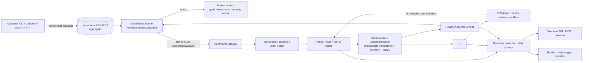
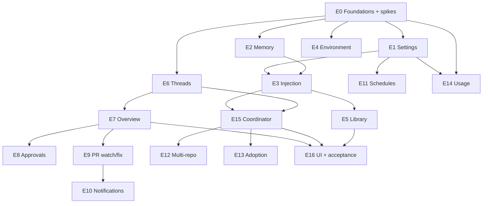

# Foreman ↔ Claude Projects: gap analysis and parity plan

Source: https://code.claude.com/docs/en/claude-projects (read in full). Foreman state verified by four read-only code scouts against `main` @ `32d51be1`.

## 1. What a Claude Project is (the target)

One long-running **coordinator conversation** per project. It triages whatever you paste in (bug, stack trace, task list), answers quick questions in place, and starts or reuses **threads** (workers: each its own session, branch, PR). Around that:

| # | Capability |
|---|---|
| C1 | Project record: name, goal, **instructions** (≤16 000 chars, sent to every thread + coordinator), model/effort for coordinator and for threads |
| C2 | **Project memory**: agent-written notes (`MEMORY.md` index + files), read by every thread, viewable/editable/deletable |
| C3 | Repositories (multi-repo; threads may add a repo to themselves), **Library** (uploaded files/folders, thread-produced files) |
| C4 | **Environment**: env vars, secrets, setup script, network policy |
| C5 | Coordinator routing + tuning ("propose before starting", "max 2 at a time", "reuse thread") + saved-to-memory preferences |
| C6 | **Overview**: threads grouped Ready for review / Waiting on you / Working / Landing / Idle / Resolved; tabs Library, PRs, Scheduled tasks; attention dot |
| C7 | Thread control: read transcript, steer in thread's own box, answer approval prompt, Stop, resolve/reopen |
| C8 | PR lifecycle: thread opens PR, **watches it** (CI failure, review comments), buttons Resolve conflicts / Fix CI / Address comments / Merge / Create PR |
| C9 | Scheduled tasks scoped to the project |
| C10 | Continue/Move **existing session into a project**; Setup recommendations |
| C11 | Pause / Archive / Delete project; per-thread/model/coordinator **usage**; thread cap |
| C12 | Notifications when a thread needs you / errors |
| C13 | Run a thread on the user's own machine (Remote Control) |

## 2. Foreman today (verified), mapped to C1–C13

| Cap | Foreman has | Gap |
|---|---|---|
| C1 | `Aggregates.Project`, open shallow-merged `config` map, `project.update`/`archive`/`reactivate`, ProjectionStore reader, CLI `project create/get/update/delete/list`, MCP `project_list/get` | **No goal, instructions, default model/effort.** `default_branch` stored but read nowhere. `paused` is a valid status that nothing enforces. No pause/reactivate CLI verbs |
| C2 | Nothing. AGENTS.md/CLAUDE.md are not injected (the harness CLI reads them from cwd) | Whole subsystem |
| C3 | One `path` per project, one worktree/PR per run. Artifacts per phase (`FOREMAN_ARTIFACT_PATH`). Jobsite `copy_to_worktree` | **No multi-repo, no library, no file store.** `VcsAdapter.clone/2` has no caller |
| C4 | `WorkerEnvironment` reads `config.env`; jobsite `hooks`, `copy_to_worktree`; docker sandbox `:network`/`:env` | **Verified bug: project `config.env` never reaches workflow-door workers** (`prepare_agent_launch` passes FOREMAN_* only). No setup script on workflow door, no secret store (secrets would sit in event payloads), no network policy |
| C5 | Intake: `task.create/approve`, BeadsWatcher (`foreman-exec`), MCP `task_create` (needs explicit workflow+description), webhooks | **No conversation layer, no triage.** Nothing picks a workflow from free text. `auto_approve:false` is a usable "propose first" gate |
| C6 | `/dashboard/runs` flat list, 2 s poll; `RunDTO` + action matrix | **No grouping, no project/thread/overview view.** ProjectionStore has no fold for `PrReady`/`MergeGate*`/`PrUpdated`; no "waiting on you" data source |
| C7 | `run.pause/cancel/resume/reset`; `run_logs/events/activity` (bounded, redacted stdout/stderr); upstream `Jido.Harness.Session` has send/steer/interrupt/respond_approval and `AgentRuntime.JidoHarness.Session` wraps it **but nothing in prod uses it**; `Aggregates.ToolCall` exists with no producers/router prefix; static per-phase `approval_mode` | **No steering, no pending-approval state, no operator→agent message**, operator-question flow ends in a no-op |
| C8 | AutoPR/PhasePR open PRs; operator-only merge gate (`merge_approve` → `run.pr.merge` with head pin); `PrMonitor` + GitHub webhook track open/merged/closed/conflicted | **No CI/review/comment awareness; `PrUpdated` has no consumer; no auto-fix; PR events hang on a terminal run** |
| C9 | Dead `Scheduler`/`SchedulerIntent` aggregates, opt-in `TriggerPoller` (not cron) | No schedules |
| C10 | Every task/jobsite already has a `project_id` (no standalone state). Session archive (`.foreman/sessions/…/manifest.json`, shipped in #565) carries request/branch/base/session ids. `foreman_doctor` MCP tool (provider readiness only) | No adopt/re-home command, no recommendations. **Workflow door discards the provider session id** |
| C11 | Archive (enforced), global caps (3 runs, 100/project), jobsite usage per iteration, claude `cost_usd` in harness events | pause unenforced; **workflow door drops usage**; no rollups; per-project cap not storable (aggregate already honours a payload override); no daily cap; Langfuse cost hard-coded 0.0 |
| C12 | `Messaging` + Telegram/Slack `Dispatcher` (durable) | **`Messaging.notify` has zero production callers** |
| C13 | All execution is on the server host; `SandboxProvider` + `Overwatch.WorkerProtocol` are the seams | Mirror feature (run on another machine) absent |

**Existing assets we reuse (this is why parity is tractable):** event-sourced CQRS with registry-generated MCP tools; `Review.Analyzer`/`Review.Capture` (shipped) as the pattern for ProjectionStore-subscriber reactors and as the session-archive source; `Review` verdicts as the coordinator's "thread reported back" signal; `Jobsite` resume plumbing; the `driver_opts[:system_prompt]` seam in `prepare_agent_launch`.

## 3. Scope: adapt, don't clone

Foreman is a self-hosted operator tool, not a hosted plan-metered service. These are **adapted or excluded**, not built literally:

- claude.ai plugins/connectors/skills → Foreman's own: project-level MCP allowlist + harness-provider config (adapt, small).
- Claude GitHub App install / SSO prerequisites → `gh` auth readiness check in recommendations (adapt).
- Plan limits, "200 threads/day", usage credits → configurable per-project daily thread cap + usage rollups (adapt).
- Mobile app, desktop-app notifications → Telegram/Slack/webhook providers (adapt); a LiveView web UI is the primary rich surface.
- Claude Tag (Slack multi-user), org controls, sharing → out of scope (Claude docs also exclude them from Projects).
- C13 inverts: Foreman is local-first, so the analogue is **remote worker threads**. Design spike only unless you ask for more (decision D2).

## 4. Target architecture

Contracts (apply to every epic, from AGENTS.md):
- All mutations are commands through `CommandGateway`; the coordinator is **system-authored** and can never call `merge_approve`/`run.pr.merge` (operator-only gate stays).
- New aggregates register a prefix in `command_router.ex aggregate_module_for/1`; new events are typed structs with `@enforce_keys`; every aggregate has a `_ -> state` catch-all.
- New MCP tools: `@schema_*` + `@tools` + `tool_*` + `Policy.@write_tools`; never merge/approve.
- One key convention per boundary (§5.4/5.4b), no bare result maps (§5.1), documentation gate on every story (CLAUDE.md, README, docs/user-guide.md, docs/cli-reference.md), no flaky tests.
- Settings ride `ProjectUpdated.config` with a whitelist normaliser in `Aggregates.Project` (the map is open, so no schema break); memory and conversation get their own aggregates.

## 5. Epics

Ordering is by dependency (details in §6). `S*` = spike (time-boxed, produces a written decision, blocks named stories).

### E0 Foundations and verified defects (no new product surface)
- Persist the **provider session id** on the workflow door (today `WorkerStarted.session_id` is a Foreman uuid) → enables continue/steer/fix-on-branch.
- Capture **usage** on the workflow door (`JidoHarnessWorker` unwraps `RunResult` to text) → `UsageRecorded`.
- Fix **project `config.env` not reaching workflow workers**; make `default_branch` consumed or remove it.
- Spikes: **S1** coordinator action mechanism (harness agent + Foreman MCP tools vs structured-JSON actions parsed by Foreman; auth/provider availability; cost). **S2** steering + approvals through `Jido.Harness.Session` headlessly for `pi` and `claude` (does `respond_approval` exist for each; one-shot `Run` → `Session` migration risk). **S3** multi-repo model (see E12). **S4** PR signal source: `gh pr view --json statusCheckRollup,reviewDecision,reviews,comments,mergeStateStatus` vs webhooks (`check_run`, `pull_request_review*`); rate limits. **S5** remote-worker feasibility (D2).

### E1 Project settings and lifecycle (C1, C11 part)
Goal, instructions (≤16 000, distinct error tuples), thread/coordinator model + effort (fallback at `phase_model/1`, `reasoning_effort` in driver opts, jobsite `agent.*`), per-project `max_concurrent_runs` and daily thread cap (pass into `command_router.ex:~195` / `project.reserve_run`), **pause/resume enforced** (task.create, reserve_run, BeadsWatcher), reactivate/pause CLI verbs, hard delete semantics decision, CLI/HTTP/MCP read+write of all of it, `project.update` whitelist normaliser.

### E2 Project memory (C2)
`Aggregates.ProjectMemory` (`project_memory:<id>`), events written/forgotten, `MEMORY.md` index + topic files (on disk under the project's `.foreman/memory/` with event-log index for audit), MCP `project_memory_{list,read,write,forget}` (write = agent-callable, operator-visible), projection reader, size caps, injection into every thread prompt (index only; files on demand, like Claude), CLI `foreman project memory …`, edit/delete by operator, redaction.

### E3 Standing-context injection (C1+C2 delivery)
One `ProjectContext` builder (instructions + memory index + repo list + library index) used by **both** doors: `prompt_template_assigns` + `driver_opts[:system_prompt]` on the workflow door, `Jobsite.Prompt.resolve`/`runner_opts` on the jobsite door. Budgeted and truncated visibly. Tests pin that instructions reach the actual `RunRequest`.

### E4 Environment (C4)
Env delivery fix (E0) hardened with test at `JidoHarnessWorker.put_env`; **secret store** (value never in event payload — reference + OS keychain/file, redaction list feeds `extract_secrets`); **setup script** on workflow worktree creation (reuse `Jobsite.Hooks` fatal-on-nonzero semantics, operator-trusted source only); network policy for docker sandbox (allowlist via sandbox network; host sandbox = documented unsupported); per-project environment record (`project.config.environment`).

### E5 Library (C3)
`ForemanServer.Library` under `<repo>/.foreman/library/` (gitignore only that path), `project.library.add|replace|remove` commands/events/projection, limits mirroring Claude's (100 files/pick, per-file 480 MB, folder = first 100 files ≤200 MB, ≤10 folders, skip hidden + `node_modules`), mounted read-only into the worktree and exported as `FOREMAN_LIBRARY_PATH`, **thread-produced files** registered from the artifact contract and archive, list API/MCP/CLI.

### E6 Threads (C7)
A **Thread** read model unifying task + run (+jobsite) with title, state, branch, PR, last report, session id. Stop (existing cancel), **resolve/reopen** (new `thread.resolve`), **steering**: `run.steer` command + `RunControl` mailbox; v1 = pause→resume with queued message injected into the next prompt (works for both providers), v2 = live `Session.steer` where S2 says it's supported; jobsite `resume_async` forwards `:prompt` (cheap seam found at `jobsite.ex:87-91`). Transcript: structured turns beside the existing bounded logs; cursor/stream tail. **Reuse existing thread** for same-area follow-ups.

### E7 Overview (C6, C12 data)
Pure `OverviewGroup` classifier (Ready for review / Waiting on you / Working / Landing / Idle / Resolved) over a new projection with folds for `PrReady`, `MergeGatePending/Approved`, `PrUpdated`, approvals, review verdicts. `GET /api/projects/:id/overview`, MCP `foreman_overview`, tabs data (Library, PRs, Scheduled). Attention flag per project.

### E8 Needs-you: approvals and questions (C7)
Wire `Aggregates.ToolCall` (router prefix, producers from `Session.respond_approval`), `tool.approve|deny` operator commands, pending-approval projection (feeds "Waiting on you"), answer command for the dead operator-question flow, timeouts that surface rather than silently no-op. Gated by S2.

### E9 PR watching and auto-fix (C8)
`PrWatcher` (ProjectionStore subscriber + poll fallback + webhooks) reading checks/reviews/comments/conflicts (S4); new PR events on the run stream and allow-list at `run.ex:766`; **fix threads**: `run.pr.fix_ci`, `run.pr.address_comments`, `run.pr.resolve_conflicts` spawn a follow-up run on the PR head branch with `push: true` + `resume_session` (needs E0), bounded retries, stop-watching command, **Create PR** for an idle thread with a pushed branch, auto-resolve on merge. Merge stays operator-only. Review verdict (#565) becomes one more PR signal.

### E10 Notifications (C12)
`Notifier` subscriber mapping RunFailed/needs-input/PR-ready/CI-failed/review-verdict to `Messaging.notify` classes (the first production producer), per-project preferences (all turns / only blocked / off), generic webhook provider; desktop = excluded.

### E11 Scheduled tasks (C9)
`Schedule` aggregate (`schedule:<project>:<id>`) reusing dormant `SchedulerIntent` fire tracking, cron/interval parser, supervised ticker emitting `task.create` with deterministic `command_id` per fire, usage-limit aware (no catch-up storm), list/create/pause/delete via CLI/MCP/API, Scheduled tab data.

### E12 Multi-repo projects (C3)
**Decision D3: true multi-repo project/run** (not linked single-repo projects). A project owns `repositories[]` (id, path, default branch, VCS/PR settings, task-provider binding optional); a single run may hold **one worktree per repository** and produce **one branch and one PR per touched repository**. Spike S3 designs the model before any code: project/aggregate shape (`ProjectRegistered.path` today is a single path), `WorktreeRecord` and `Workflow.Worktree` changes, `RunExecutor` project_root/repo_path/base-branch derivation, per-repo artifact and base-branch env (`FOREMAN_WORKTREE_PATH` becomes a map plus a primary), AutoPR/PhasePR per repo, merge gate per PR (still operator-only), PR watching per PR (E9), `Jobsite` multi-repo spec, Review archive diff per repo, BeadsWatcher/provider scoping, prompt context listing every repo with its path, "thread adds a repo to itself" gated by an operator allowlist, and migration of existing single-path projects (a single-element `repositories[]` is the default so nothing existing changes). Goal fan-out (one thread per repo) remains available as a special case for independent per-repo work.

### E13 Adoption and recommendations (C10)
`project.adopt` (re-home a task/jobsite/run + its archive into a project; mint project from a session via the archive manifest), `foreman project recommend` / MCP `project_recommendations` (detect `.beads`, AGENTS.md, CI, `gh` auth, workflow install, missing instructions/env), first-turn setup proposal posted into the conversation.

### E14 Usage and cost (C11)
`UsageRecorded` projection by project/thread/model/coordinator, `GET …/usage`, MCP, CLI `foreman usage`, daily thread cap enforcement with visible rejection, Langfuse cost fix, cache-lifetime hint in coordinator guidance.

### E15 Coordinator (C5) — the centre piece
`coordinator:<project>` aggregate (`coordinator.message`, `CoordinatorMessageAppended`, reply/action events), `Coordinator.Runner` (subscriber, per-project serialized, bounded context = recent messages + recent thread cards + memory + instructions — never full history), action vocabulary: start thread / propose threads / route to existing thread / answer in place / remember or forget / adjust tuning / add repo / schedule. Free-text → workflow selection (replaces the missing `Catalog.type_to_workflow` for text). Tuning preferences stored as memory **and** as enforced per-project limits where Foreman can enforce them (an improvement over Claude's "preference, not a cap"). Receives review verdicts and PR events. Coordinator model/effort from E1. Restart/health ("Claude hasn't responded" analogue), idempotent via deterministic command ids, crash-safe replay (no duplicate threads).

### E16 Surfaces and acceptance
CLI `foreman project {pause,resume,reactivate,settings,memory,library,overview,chat,threads,schedule,usage,recommend}` + `thread` verbs; MCP tools for each read/write (never merge); **LiveView project workspace** (conversation + Overview pane + Library/PR/Schedule tabs + settings), stable `/dashboard/projects/:id`; docs rewrite (also correct stale `NOT IMPLEMENTED` entries in `docs/cli-reference.md`); **live end-to-end acceptance** reproducing Claude's flow on a scratch repo: create project → instructions + memory → paste 3 tasks → threads run → one PR gets CI failure → fix thread → ready-for-review → operator merges → resolved.

## 6. Phasing and dependencies

| Phase | Epics | Outcome |
|---|---|---|
| P0 | E0 | Spikes decided; session id, usage, env delivery fixed |
| P1 | E1, E2, E3, E4 | Project has goal/instructions/memory/env that **actually reach agents** (already valuable standalone) |
| P2 | E6, E7, E14, E5 | Threads, Overview with groups, usage, library |
| P3 | E9, E8, E10, E11 | PRs watched and fixed, approvals, notifications, schedules |
| P4 | E15, E12, E13 | Coordinator conversation, multi-repo, adoption |
| P5 | E16 | UI, docs, live acceptance |

E15 sits late because it is only as good as the thread/overview/PR plumbing it drives; E1–E4 are shippable value on their own, so the work lands incrementally rather than as one big bang.

## 7. Risks and honest caveats

- **Coordinator quality** is a prompt+tool-design problem, not a plumbing one; S1 must prove routing on realistic inputs before E15 is committed. Provider availability today: claude OAuth expired, LiteLLM host unreachable; only `pi`+MiniMax is verified working — the coordinator must be provider-configurable like the review agent.
- **Steering workflow-door agents** is one-shot `Jido.Harness.Run` today; true live steering needs `Session` adapters nothing in prod has exercised (S2). v1 pause→resume injection is the safe floor.
- **PR watching on a terminal run** (events attach after `run.complete`) needs the aggregate allow-list widened carefully; fix threads must not re-trigger themselves (bounded depth, like the gap-bead guard in #565).
- **Secrets**: nothing today keeps them out of event payloads; E4 must not ship a store that logs values.
- **Test hygiene**: AGENTS.md treats flakes as build failures; every named-server test uses `start_supervised!`; each story carries its own tests.
- **BeadsWatcher auto-dispatches any bead labelled `foreman-exec`.** The tracking beads created from this plan will **not** carry that label until you choose to start building.
- Scale: roughly 16 epics, ~55 stories, 200+ tasks/tests; weeks of work, not a session.

## 8. Decisions requested
Taken: **D1 harness agent + Foreman tools** (the coordinator is a configurable provider agent acting through Foreman commands/MCP tools, same shape as the review agent; spike S1 must prove routing quality and provider availability before E15 is committed). **D2 design spike only** (S5 is the whole remote-worker scope). **D3 true multi-repo project/run** (see E12; largest and riskiest epic, hence design-first with S3). **D4 API/MCP/CLI first, then LiveView workspace** (E16 delivers the LiveView last).

## 9. Revision: Jido review (applied to beads)
- E15/S1: the tool loop is provider-independent (tools as `Jido.Action` -> `CommandGateway`; model behind the `[:pi, :claude]` harness). `Jido.AI.Reasoning.ReAct` is one swappable implementation S1 evaluates, never the default mechanism; no provider-from-model-name routing, no second LLM boundary. S1 must pass on `pi` + `minimax/MiniMax-M2.7-highspeed`.
- New story E0-S4: make `ForemanServer.Agents.JidoAiRunner` honest (no placeholder success, typed Result/Error, contract-pinned tests, real cost). Precondition only for evaluating ReAct, not for E15.
- E11-S2: evaluate declaring `crontab` explicitly (already transitive via jido) instead of a hand-written cron parser; do not adopt `Jido.Scheduler` (second persistence story).
- E0-S2-T1: evaluate `Jido.AI.Usage` for the merge step only.
- Rejected: `Jido.Memory/Thread/Persist/Pod/Plan`, `jido_mcp` server bridge, `jido_shell`.
